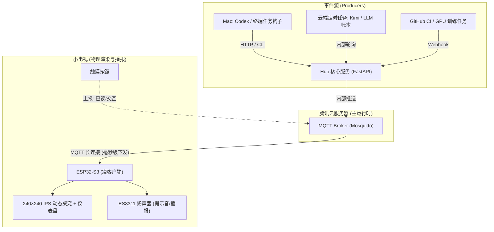

# SPEC-001: Desk Sprite 系统架构与通信契约

## 1. 架构总览

采用 **“瘦物理边缘端，强云端大脑 (Thin Edge, Fat Cloud)”** 架构：



---

## 2. 通信协议定义 (JSON Envelope)

### 2.1 常规指标更新 (`metrics`)
- **Topic**: `sprite/device/metrics`
- **Payload**:
```json
{
  "type": "metrics",
  "data": {
    "bars": [
      {"label": "Kimi 5H", "value": 0, "max": 100},
      {"label": "Kimi Week", "value": 0, "max": 100},
      {"label": "Kimi Total", "value": 83, "max": 100}
    ],
    "pet_mood": "idle"
  }
}
```

### 2.2 事件弹窗与播报 (`alert`)
- **Topic**: `sprite/device/alert`
- **Payload**:
```json
{
  "type": "alert",
  "data": {
    "title": "Codex 任务完成",
    "sub": "耗时 3m12s · 花费 1.2k tokens",
    "sound": "ding",
    "pet_mood": "cheer",
    "duration_sec": 10
  }
}
```

### 2.3 物理交互上报 (`touch_event`)
- **Topic**: `sprite/server/event`
- **Payload**:
```json
{
  "type": "touch_event",
  "action": "tap",
  "timestamp": 1793614000
}
```
