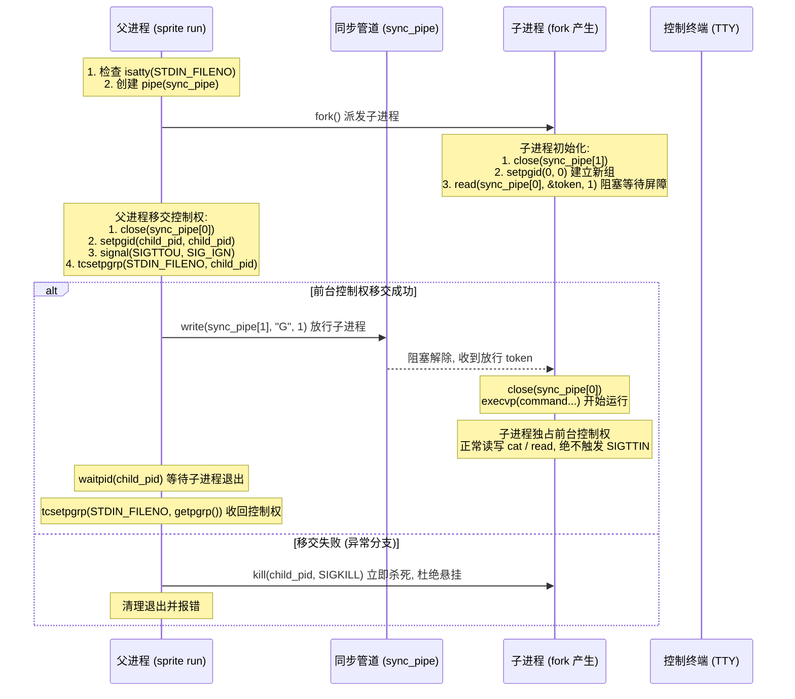

# SPEC-004: Mac 客户端与本地守护进程 (CLI & Daemon)

- **版本**: 1.4.0 (深度闭环版)
- **状态**: 待复审
- **更新日期**: 2026-11-02
- **关联规范**: [SPEC-001 系统架构](001-system-architecture.md), [SPEC-002 通信协议](002-protocol-and-events.md), [SPEC-003 视觉与状态机](003-sprite-display-and-state-machine.md)

---

## 1. 模块定位与职责

Mac 客户端包含两个子模块：
1. **`sprite` 命令行工具 (CLI)**：用于日常脚本、CI 命令包装（`sprite run`）与状态管理。
2. **`sprite-daemon` 后台守护进程**：常驻运行，负责本地前台应用状态感知、监听云端动作下发并在 Mac 上安全打开目标网页。

---

## 2. 命令行工具设计 (`sprite` CLI)

### 2.1 基础通知推送 (`sprite notify`)

```bash
sprite notify "<title>" [summary] [options]
```

#### 参数与协议显式映射表
所有 CLI 参数与 [SPEC-002](002-protocol-and-events.md) 协议字段严格对齐：

| CLI 参数 | 简写 | 默认值 | 映射协议字段 | 允许的合法值 / 规则 |
| :--- | :---: | :---: | :---: | :--- |
| `--level` | `-l` | `medium` | `priority` | `low`, `medium`, `high` (严禁使用 `info`) |
| `--sound` | `-s` | `ding` | `sound` | `none`, `ding`, `chime`, `cheer`, `sigh`, `alert_beep` |
| `--mood` | `-m` | `cheer` | `pet_action` | `idle`, `coding`, `meeting`, `cheer`, `sigh`, `alert`, `sleep` |
| `--url` | `-u` | 空 | `url` | 结构化 HTTP/HTTPS 链接 (由云端存入 EventStore) |
| `--device` | `-d` | 配置文件默认 | `target_device` | 指定下发的硬件设备 ID (纯字符串，如 `esp32_c049ef`) |

- **执行退出码规范**:
  - `0`: 通知已成功发送并被云端接收。
  - `1`: 本地配置缺失或参数非法（如使用了非法枚举值）。
  - `2`: 网络不可达或云端鉴权失败（401 / 403）。

---

### 2.2 命令包装执行器 (`sprite run`) (H02 闭环)

`sprite run -- <command...>` 用于包装耗时任务，执行完毕后自动触发桌宠视听联动反馈。

#### 管道同步屏障与前台控制权契约 (H02 闭环)
为了彻底消灭独立子进程组在执行 `execvp` 前因父进程未完成 `tcsetpgrp` 而提前读取终端导致的 `SIGTTIN` 挂起竞态，执行器严格实施 **“管道单向同步屏障 (Pipe-based Sync Barrier)”**：



#### 严格执行算法与契约
1. **控制终端交互环境 (`isatty(STDIN_FILENO) == 1`)**:
   - `fork()` 之前建立单向管道 `pipe(sync_pipe)`（均设 `O_CLOEXEC` 标志）。
   - **子进程逻辑**:
     - 关闭写端 `close(sync_pipe[1])`。
     - 调用 `setpgid(0, 0)` 将自身设为新进程组。
     - **阻塞屏障**: 调用 `read(sync_pipe[0], &token, 1)`。在未收到父进程确认前，**绝对不调用 `execvp`，绝对不发起任何终端读写**！
     - 收到 token 后，`close(sync_pipe[0])`，执行 `execvp` 运行目标命令。
   - **父进程逻辑**:
     - 关闭读端 `close(sync_pipe[0])`。
     - 调用 `setpgid(child_pid, child_pid)`。
     - 忽略 `SIGTTOU` 信号。
     - 调用 `tcsetpgrp(STDIN_FILENO, child_pid)` 将终端前台控制权移交给子进程组。
     - **解除屏障**: 写入 1 字节 `write(sync_pipe[1], "G", 1)` 并关闭写端。
     - **失败兜底**: 若 `tcsetpgrp` 失败，向子进程发送 `SIGKILL`，关闭管道，清理退出并向 stderr 报错，**绝对不遗留挂起进程**。
     - **前台控制权回收**: 子进程退出后，父进程调用 `tcsetpgrp(STDIN_FILENO, getpgrp())` 收回前台控制权并恢复终端原有属性。
2. **非终端环境 (管道 / 重定向 / CI)**:
   - 若 `!isatty(STDIN_FILENO)`：不创建同步管道，不调用 `tcsetpgrp`。直接继承 FD 0/1/2，父进程捕获 `SIGINT` 与 `SIGTERM` 并转发给子进程组。
3. **退出码规范**:
   - 子进程正常退出：`sprite run` 返回子进程相同的退出码。
   - 因信号终止：返回 `128 + 信号编号`（SIGINT 为 130，SIGTERM 为 143）。
   - 命令不存在返回 127，无权限返回 126。
4. **有限超时保护**:
   - 命令结束后发送 HTTP 通知，设置 **3.0 秒硬超时**。失败仅向 `stderr` 打印警告，绝不篡改原命令退出码。

---

### 2.3 工作状态手动设置与覆盖恢复

```bash
# 手动设置状态 (进入 30 分钟临时锁定期)
sprite state set <idle|coding|meeting|sleep>

# 提前解除锁定，恢复后台自动探测
sprite state auto
```

---

## 3. 本地守护进程设计 (`sprite-daemon`)

### 3.1 锁屏瞬时事件驱动与轮询流水线

1. **锁屏瞬时上报 (Event-driven)**:
   - 监听 macOS `com.apple.screenIsLocked` 广播通知：一旦触发，**在 500ms 内立即向 MQTT 上报 `work_mode: "sleep"`**。
   - 监听 `com.apple.screenIsUnlocked` 广播：立即触发一次前台状态刷新。
2. **前台应用探测与 15 秒防抖 (3s 周期轮询)**:
   - 仅在非锁屏且未处于手动覆盖（TTL 30m）期间，每 3 秒检测一次 `NSWorkspace.shared.frontmostApplication`：
     - 匹配 `coding` 列表（VS Code, Cursor, Xcode 等）：持续维持 15 秒后上报 `coding`。
     - 匹配 `meeting` 列表（Zoom, 腾讯会议等）：持续维持 15 秒后上报 `meeting`。
     - 未匹配应用（Finder, 微信, 浏览器等）且键鼠在 5 分钟内有操作：判定为 `idle`。
     - 键鼠无操作连续超过 5 分钟：判定为 `idle`。

---

### 3.2 反向动作执行器、并发原子性与重启边界

守护进程长连接订阅：`sprite/host/{host_id}/down/command`。

#### 并发去重与原子登记契约
1. **原子登记 In-Flight**:
   - 守护进程维护容量为 500 的内存 LRU 集合（记录最近 10 分钟已处理命令）。
   - 收到命令后，**在调用系统指令之前，先原子化检查并占位**：
     - 若 `command_id` 已存在于集合中：立即上报 ACK `status: "duplicate_ignored"`，**严禁调用系统 open**！
     - 若不存在：先写入集合，状态标记为 `executing`。
2. **有效期拦截**:
   - 若 `now > expire_at`，标记为 `expired` 并上报 ACK，不调用 open。
3. **结构化 URL 校验与系统调用**:
   - 标准 URL 解析器校验（限定 http/https，无空格分号，无 userinfo，长度 ≤512）。
   - 必须通过参数数组执行系统命令（`exec.Command("/usr/bin/open", validatedUrl)`），严禁使用 Shell 拼接。
   - 执行成功更新状态为 `success`，上报 ACK。
4. **重启边界与会话声明**:
   - 去重 LRU 集合存储于守护进程内存中，不进行跨进程落盘。
   - 客户端 MQTT 连接固定配置为 **`clean_session = true`**（干净会话），不保留离线指令。
   - 结合指令自身的 `expire_at`（60 秒有效），进程重启后超过 60 秒的陈旧指令被直接丢弃，不发生意外回放。

---

## 4. 守护进程运维与配置契约

### 4.1 LaunchAgent 绝对路径配置
安装脚本动态获取 `$HOME` 绝对路径生成 `~/Library/LaunchAgents/com.sprite.daemon.plist`：

```xml
<?xml version="1.0" encoding="UTF-8"?>
<!DOCTYPE plist PUBLIC "-//Apple//DTD PLIST 1.0//EN" "http://www.apple.com/DTDs/PropertyList-1.0.dtd">
<plist version="1.0">
<dict>
    <key>Label</key>
    <string>com.sprite.daemon</string>
    <key>ProgramArguments</key>
    <array>
        <string>/usr/local/bin/sprite-daemon</string>
        <string>run</string>
    </array>
    <key>RunAtLoad</key>
    <true/>
    <key>KeepAlive</key>
    <true/>
    <key>StandardOutPath</key>
    <string>/Users/liruoxuan/.sprite/daemon.log</string>
    <key>StandardErrorPath</key>
    <string>/Users/liruoxuan/.sprite/daemon.err</string>
</dict>
</plist>
```
- 前置创建 `~/.sprite`（权限 `0700`），日志文件权限 `0600`。

### 4.2 本地配置文件契约 (`~/.sprite/config.json`)
文件权限严格限定为 `0600`：

```json
{
  "cloud_endpoint": "https://sprite.example.com",
  "mqtt_broker": "mqtt.example.com",
  "mqtt_port": 8883,
  "host_id": "macbook_pro",
  "target_device_id": "esp32_c049ef",
  "api_key": "spr_live_xxxxxxxxxxxxxxxx",
  "mqtt_username": "host_macbook_pro",
  "mqtt_password": "spr_mqtt_secret_xxxxxxxx",
  "state_monitor": {
    "enabled": true,
    "idle_timeout_sec": 300,
    "debounce_sec": 15,
    "manual_override_ttl_sec": 1800
  }
}
```

---

## 5. 验收标准与验证命令 (Verification Matrix) (H02 闭环)

| 需求项 | 验证入口与命令 | 预期结果 |
| :--- | :--- | :--- |
| **管道同步屏障 (消除 SIGTTIN 竞态)** | 模拟父进程交接延迟 200ms，子进程执行 `sprite run -- bash -c 'read -p "Name:" n && echo "Hi $n"'` | 子进程在屏障处安全阻塞，待父进程完成交接后正常提示输入并回显，**不触发 SIGTTIN 挂起** |
| **交接失败不留挂起进程** | 模拟父进程 `tcsetpgrp` 人为触发失败 | 父进程捕获错误并向子进程发送 `SIGKILL`，正常清理管道退出，无后台残留僵尸进程 |
| **管道与非 TTY 流式透传** | `sprite run -- cat /etc/hosts \| grep "localhost"` | 管道无阻塞流式输出，不破坏原有终端管道生态 |
| **Ctrl-C 信号状态码** | `sprite run -- sleep 100` 后按下 `Ctrl-C` | 子进程立即退出，进程不残留，退出码严格为 `130` (128+2) |
| **Mac 命令并发去重** | 模拟使用相同 `command_id` 并发两次推入守护进程 | 浏览器仅调用系统打开 1 次，第 2 次原子拦截并返回 `duplicate_ignored` |
