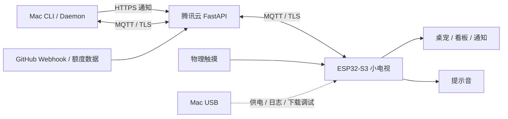

# SPEC-005：USB 小电视系统规格说明书（实机核验版）

- 版本：1.4.0
- 检测日期：2026-11-03；云端联调更新2026-11-05，Asia/Shanghai
- 对象：当前连接 Mac 的 Espressif USB 设备，序列号 `D8:3B:DA:4A:E9:84`
- 状态：当前运行 Desk Sprite，腾讯云 TLS 通知及提示音通过实物验收，重启可自动连接；触摸交互、录音、动态桌宠、真实额度及长期稳定性待完成
- 目的：建立这台实机的开发基线，区分硬件事实、软件配置和产品目标。

> 实机适配以本文第 3.0、4.0 节和[板级核验记录](../docs/hardware/2026-11-03-usb-inspection/board-validation.md)为准，机器可读清单见 [board-profile.json](../docs/hardware/2026-11-03-usb-inspection/board-profile.json)。第 3.1～3.2、4.1～4.3 节保留恢复前 Desk Sprite 检测快照，其中引脚不适用于本机。恢复过程见[恢复记录](../docs/hardware/2026-11-03-usb-inspection/recovery.md)及 [SPEC-006](006-device-firmware-recovery.md)，核验契约见 [SPEC-007](007-board-hardware-validation.md)。

## 1. 核验结论与证据分级

这是一台基于 ESP32-S3 的嵌入式终端：双核程序启动、CPU 240MHz、8MB Flash、8MB Octal PSRAM。2026-11-05 已从 Kimi 看板切换到 Desk Sprite，完成公网 HTTPS → 腾讯云 MQTT TLS → 实机通知；用户确认画面和声音正常，重启后自动联网。独立 RAM 诊断的 RGB 彩条、四边粗框/底部四色带已获实物照片确认。S3整板图把顶部TP_KEY直连GPIO5、录音数据接GPIO15；GPIO5原生电容600次读取完成，但三次动作的可靠按下/松开关联仍未通过。当前额度是模拟数据。

USB 描述符不能给出整机物料与 PCB 接线。现已通过匹配旧固件资料、独立外设测试和用户提供原理图交叉核对显示与音频基线。SPEC-001/003 中的 DevKitC-1、1.54 寸 IPS、TTP223 仍是参考方案，不能作为本机物料事实；GPIO4 实测用于音频输出。卖家图纸中的触摸电极直接接GPIO5，不能沿用TTP223数字输入方式。两份12针屏规格与整板FPC定义不同，屏幕具体料号仍未匹配。

| 标记 | 含义 | 使用范围 |
| --- | --- | --- |
| 实测 | USB、esptool、启动日志、独立 RAM 诊断及用户实物观察 | 芯片、存储、已验收外设路径 |
| 图纸 | 卖家 S3 整板原理图声明，尚未逐项核对实物装配 | 触摸电极接线、录音接线、背光电路及物料标号 |
| 配置 | 当前源码或构建配置声明，未必等于硬件事实 | GPIO、屏幕分辨率、SPI 时钟 |
| 目标 | 现有系统规范定义的预期行为 | 桌宠、通知、云端联动 |
| 待确认 | 缺少直接证据 | 成品型号、屏幕物理参数、外围芯片及电气指标 |

### 1.1 原始检测记录

| 文件 | 内容 |
| --- | --- |
| [usb-device.json](../docs/hardware/2026-11-03-usb-inspection/usb-device.json) | 检测时间、USB 标识、链路速率、串口路径 |
| [chip-and-flash.txt](../docs/hardware/2026-11-03-usb-inspection/chip-and-flash.txt) | esptool 芯片、晶振、Flash 容量及标识 |
| [boot-and-runtime.log](../docs/hardware/2026-11-03-usb-inspection/boot-and-runtime.log) | 启动、PSRAM 自检、分区、CPU、外设初始化及填屏循环 |

首轮检测只执行 USB 枚举、串口采集和 `flash_id`，未写 Flash。后续已执行 Kimi 镜像恢复、可回滚 NVS 试验及独立 RAM 诊断；NVS 已恢复到该试验前状态，各轮证据见[板级核验记录](../docs/hardware/2026-11-03-usb-inspection/board-validation.md)。未修改 eFuse。串口打开及下载操作可能复位设备，不能视为完全无扰动观测。

## 2. 实机硬件规格

### 2.1 主控与存储

| 项目 | 参数 | 证据与限制 |
| --- | --- | --- |
| 主控 | ESP32-S3，QFN56，revision v0.2 | 实测：esptool |
| CPU | 双核，当前频率 240MHz | 实测：Multicore app、CPU0/CPU1 调度启动、240000000Hz |
| 外部晶振 | 40MHz | 实测：esptool |
| 无线能力 | Wi-Fi、BLE | Wi-Fi 获取IP、云端TLS已实测；BLE未测 |
| 基础 MAC | `d8:3b:da:4a:e9:84` | 实测：esptool；不能直接当作所有网络接口的 MAC |
| Flash | 8MB；厂商 ID `0xC8`，器件 ID `0x4017` | 实测：flash_id；启动驱动识别为 `gd` |
| Flash 当前访问模式 | DIO，80MHz | 实测：启动日志 |
| Flash 接口/电压配置 | eFuse 报告 Quad、3.3V | 实测：esptool；不是电压表测量结果 |
| PSRAM | 8MB，Octal，80MHz | 实测：启动检测、8192K 加入堆 |
| PSRAM 厂商/密度 | `0x0D (AP)`、64Mbit、3V 档 | 实测：PSRAM 寄存器报告；64Mbit = 8MiB |
| PSRAM 自检 | 通过 | 实测：`SPI SRAM memory test OK` |
| 内部可分配内存 | 启动列出约 316KiB DRAM、21KiB STACK/DRAM、32KiB DRAM、7KiB RTCRAM | 实测：启动时堆区域；不是芯片 SRAM 总容量或持续可用内存 |
| DMA/内部内存保留池 | 32KiB | 实测：启动日志；不能将全部 PSRAM 视为任意外设可直接 DMA 的内存 |
| 模组及整机型号 | 待确认 | 8MB Flash + 8MB PSRAM 不足以证明采用 DevKitC-1-N8R8 |

说明：工具容量标签沿用 `MB`；资源预算按二进制字节计算，例如 8MiB = 8,388,608 字节。

### 2.2 USB 与供电

| 项目 | 参数 | 状态 |
| --- | --- | --- |
| USB 厂商 | Espressif | 实测 |
| USB 产品 | USB JTAG/serial debug unit | 实测；表示调试接口，不是整机商品名称 |
| VID / PID | `0x303A / 0x1001` | 实测 |
| USB 序列号 | `D8:3B:DA:4A:E9:84` | 实测 |
| USB 协议描述 | `bcdUSB = 0x0200` | 实测：USB 2.0 描述 |
| 当前链路速率 | 12Mbit/s，Full Speed | 实测；不是 USB 2.0 的 480Mbit/s 高速模式 |
| 接口用途 | 芯片内置 USB Serial/JTAG，串口日志与下载调试 | 实测；未枚举成通用视频显示器 |
| 串口 | `/dev/cu.usbmodem11201` | 实测；重新插拔后路径可能改变 |
| 串口采集设置 | 115200、8N1 | 本次采集配置；不是 USB 链路速率 |
| USB 拓扑 | 经 USB 2.0 Hub 接入 Mac | 实测 |
| macOS 记录的供电分配 | `UsbPowerSinkAllocation = 500` | 系统记录，通常以 mA 表示；不是实测耗电或整机额定功率 |
| 供电连接器/电池/功耗 | S3图纸为USB Type-C、+5V输入、3V3逻辑网 | 图纸未画充电/电量检测电路；未拆机或测电流，不能由此确认实物电池或额定功耗 |

## 3. 显示、音频与输入接口

### 3.0 当前实机适配基线

| 功能 | 参数 / GPIO | 验收状态 |
| --- | --- | --- |
| 显示 | ST7789 兼容命令集，240×240 逻辑画布，RGB565、RGB、反色 | Mode3 彩条及粗边界照片确认；控制器后缀、单像素范围和其它方向待确认 |
| 显示 SPI | MOSI1、SCLK18、DC17、RESET6；Mode3，27MHz | 独立 RAM 实屏通过；Mode0 诊断曾黑屏 |
| 显示 CS / MISO | 软件均为 -1 | 未使用独立片选和读线；不推断物理接法 |
| 背光 | GPIO2；AO3401 P沟道高边开关；测试5kHz、8bit、raw205 | 图纸推导低有效，与卖家反向PWM源码一致；亮度曲线、极性变化、休眠唤醒待实测 |
| 音频控制 | ES8311，I2C地址0x18，SDA40、SCL39、100kHz | FD=0x83、FE=0x11、FF=0x00 |
| 音频数据 | MCLK38、BCLK16、WS7、DOUT4 | 16kHz/16bit、同值双声道，MCLK配置4.096MHz；用户确认提示音 |
| 功放 | EN8，高电平播放；图纸U9=NS4150B | 播放路径通过；功放丝印未核验 |
| 录音 | 图纸ES8311 ASDOUT → MCU GPIO15 | 麦克风标注GMI4015P-2C-42db；实物装配及录音未测 |
| 扬声器 | 图纸SPK1=FS-2308 | 已听到提示音；具体物料、阻抗与功率未核验 |
| 触摸 | 顶部单键；图纸TP_KEY直连GPIO5，原生电容通道5 | 600次电容读取无错误，但按下/松开关联未通过；产品中禁用，GPIO4不可复用 |

固定旧源码及镜像差异证据见[板级核验记录](../docs/hardware/2026-11-03-usb-inspection/board-validation.md)。2026-11-05 产品固件已使用本表显示/音频引脚，通知画面及提示音通过用户确认；云端配置与分区须遵循 SPEC-009，触摸上报保持禁用。

S3原理图原件已取得，SHA256 `840b5900d0ba32935f07a8d8fa5649377ef34da617d5730c5b82056648db7a76`。图中FPC1是12针：1/3/8/10/11/12=GND，2=AO3401输出，4=3V3，5=RESET，6=SDA，7=SCL，9=DC。两份H12-07/C12-01屏规格的相同编号定义不同，不能按“1.54寸”目录或针数认定实际料号，也不能作为替换屏接线依据。详细来源、引脚对照与触摸试验见[卖家资料核对](../docs/hardware/2026-11-03-usb-inspection/seller-materials-review.md)。

### 3.1 恢复前显示配置（历史快照，禁止用于本机适配）

| 项目 | 当前参数 | 证据与限制 |
| --- | --- | --- |
| 显示驱动 | `esp_lcd_new_panel_st7789` | 配置；没有读取屏幕控制器 ID |
| 逻辑分辨率 | 240 × 240 像素 | 配置；尚未通过实物画面核验边界 |
| 像素格式 | 16bit RGB565，驱动设置 BGR、反色开启 | 配置；实际色序、方向、偏移待目视校准 |
| 总线 | SPI2，Mode 0，MOSI 单向写入，MISO 未连接到驱动 | 配置；不能靠此驱动读取屏幕身份 |
| SPI 时钟 | 20MHz | 配置；未用逻辑分析仪实测 |
| 命令/参数位宽 | 各 8bit | 配置 |
| 背光 | LEDC，5kHz、8bit PWM、亮度接口 0–100% | 配置；当前主程序最终设置 80% |
| 测试循环 | 每 1500ms 请求整屏填充，红/绿/蓝/黄/白循环 | 源码与实机日志一致；日志成功不等于屏幕实际正确发光 |
| 屏幕尺寸/IPS/亮度/视角 | 待确认 | 参考方案声明 1.54 寸 IPS，本次 USB 检测不能证实 |

**当前固件使用的引脚表**（运行日志与源码一致，尚未做 PCB 连通验证）：

| 信号 | GPIO | 与旧 SPEC-003 参考方案对比 |
| --- | --- | --- |
| LCD MOSI | 39 | 旧值 11 |
| LCD SCLK | 38 | 旧值 12 |
| LCD CS | 21 | 旧值 10 |
| LCD DC | 45 | 旧值 9 |
| LCD RESET | 40 | 旧值 14 |
| LCD 背光 | 46 | 旧值 48 |

实机适配应以已验证的板级接线为准，不能将旧参考引脚表直接用于这台设备。

### 3.1.1 SD2 参考资料（核验前记录）

下表保留发现时的证据等级；最新实测结果以第 3.0 节为准。

同级 `kimi-pocket` 保存了 SD2 Kimi 看板完整镜像与原厂备份；用户确认黑屏前运行 Kimi 额度看板。相关 QuotaClock 源码提供了另一组板级配置，与上表不一致：

| 信号 | SD2 / QuotaClock 参考配置 | 证据范围 |
| --- | --- | --- |
| LCD 控制器、分辨率 | ST7789_2、240×240、RGB、SPI 27MHz | TFT_eSPI 配置；未读取控制器 ID |
| LCD MOSI / SCLK | GPIO1 / GPIO18 | 参考源码 |
| LCD DC / RESET / 背光 | GPIO17 / GPIO6 / GPIO2 | 参考源码；不能沿用当前 GPIO46 背光声明 |
| LCD CS | 此配置未定义独立 TFT_CS | 不推断其物理接法 |
| ES8311 控制总线 | I2C SDA40 / SCL39，地址 0x18 | 外部项目原理图摘录，未本机探测 |
| ES8311 音频总线 | MCLK38 / BCLK16 / WS7 / MCU输出4 | 外部项目原理图摘录，未播放验收 |
| NS4150B 功放使能 | GPIO8，高有效 | 外部项目原理图摘录，未播放验收 |

固定版本来源：[User_Setup.h](https://github.com/akechi1980/QuotaClock/blob/defb2c83986de0bf88b826a716f0d0415315d2f4/vendor/clock_rom/libraries/TFT_eSPI/User_Setup.h)、[AUDIO_BOARD.md](https://github.com/akechi1980/QuotaClock/blob/defb2c83986de0bf88b826a716f0d0415315d2f4/clock_rom/AUDIO_BOARD.md)。这是较强的板型线索，但仍需旧镜像恢复结果或 PCB 核对确认，不能把外部资料自动标为本机实测。

### 3.2 恢复前音频与触摸配置（历史快照，禁止用于本机适配）

| 功能 | 当前代码声明 | 实际验证程度 |
| --- | --- | --- |
| 音频 Codec | ES8311 | 未读取 I2C 芯片身份，芯片是否存在待确认 |
| I2S | BCLK=15、LRCK=16、SDOUT=17 | 只有宏定义；初始化未配置 I2S 输出 |
| 音频控制 I2C | SDA=18、SCL=8 | 只有宏定义；初始化未配置 I2C 或 Codec 寄存器 |
| 功放使能 | PA_EN=47，高有效 | 代码已将 GPIO47 配为输出并拉低；实际是否接功放待确认 |
| 音量 | `bsp_es8311_set_volume()` | 当前只打印日志，没有实际设置 Codec 音量 |
| 触摸 | TTP223、GPIO4、高电平有效 | 代码只初始化 GPIO 输入和提供读取函数；芯片及触摸电平变化未测 |
| 触摸手势 | 纯逻辑代码定义单击和 ≥1200ms 长按 | 当前 `app_main()` 未轮询手势、未上报动作；实机交互未接入 |
| 扬声器/麦克风 | 待确认 | 无声学测试或板级物料证据 |

“HAL 初始化成功”只证明这段初始化代码执行完成，不能证明音频播放或触摸芯片正常。

## 4. 当前软件系统与存储布局

### 4.0 当前 Desk Sprite 固件

ESP-IDF 5.1.2；应用1,051,984字节，factory分区0x10000/0x300000、NVS分区0x9000/0x5000、PHY分区0xf000/0x1000。Wi-Fi/MQTT凭据仅从私有NVS读取，SNTP完成后建立MQTT TLS并校验证书。公网通知、用户实物显示/提示音确认、重启自动连接均通过；桌宠仍静态占位，三行额度为模拟数据，无OTA。完整备份摘要、实机事件ID、构建与回滚命令见[2026-11-05联调记录](../docs/hardware/2026-11-05-cloud-trial.md)。

### 4.0.1 刷写前 Kimi 看板（历史快照）

刷写前为 Arduino / ESP-IDF 4.4.5 的 `SDD MONO 0.2.6-dev` Kimi 看板镜像，SHA256 `b80ab84c9d62ac119ca38e395f23266bfceb542859599597e012ecbd661645a6`。恢复后主要区域已校验；旧网络配置试验已回滚。屏幕显示 Kimi 不代表已联网或额度为真实最新数据。

| 分区 | 起始地址 | 长度 |
| --- | --- | --- |
| nvs | 0x9000 | 0x5000（20KiB） |
| otadata | 0xe000 | 0x2000（8KiB） |
| app0 | 0x10000 | 0x300000（3MiB） |
| spiffs | 0x310000 | 0xe0000（896KiB） |
| coredump | 0x3f0000 | 0x10000（64KiB） |

新 Desk Sprite 分区已由 SPEC-009 定义，不直接继承旧看板布局。此前用户动线时诊断运行约15秒出现 USB 掉线；连接恢复后三轮60秒诊断及60秒原生触摸诊断均完整结束、串口已关闭。故障具体位置及此前间歇黑屏的全部原因仍未知。

### 4.1 恢复前已运行固件（历史快照）

| 项目 | 实测值 |
| --- | --- |
| 工程名称 | `desk_sprite` |
| ESP-IDF | v5.1.2（bootloader 与应用一致） |
| 应用构建版本 | `12c63ba-dirty` |
| 应用启动横幅 | `Desk Sprite ESP32-S3 Firmware v1.4.0`，是代码字符串，不代表功能验收版本 |
| 应用编译时间 | 2026-11-03 13:46:29，设备镜像内的时间字符串 |
| ELF SHA256 前缀 | `2355572d2a634060`，设备日志只输出前缀 |
| 启动结果 | 已进入 `app_main()`，持续输出填屏日志 |
| FreeRTOS tick | 1000Hz，来自当前 `sdkconfig`，非本次硬件计时测量 |
| 控制台 | 当前 `sdkconfig`：UART0 主控制台，USB Serial/JTAG 辅助控制台；USB 日志可读已实测 |

### 4.2 恢复前设备启动报告的分区（历史快照）

| 分区 | 类型/用途 | 起始地址 | 长度 |
| --- | --- | --- | --- |
| `nvs` | 数据，NVS | `0x9000` | `0x6000`，24KiB |
| `phy_init` | 数据，RF 参数 | `0xF000` | `0x1000`，4KiB |
| `factory` | 单应用固件 | `0x10000` | `0x100000`，1MiB |

分区表位于 `0x8000`（当前构建配置），应用从 `0x10000` 启动（实测）。虽然 Flash 总容量为 8MB，当前 factory 应用槽只有 1MiB；不能把整颗 Flash 容量当作固件镜像上限。当前分区未提供 OTA 双槽或专用素材文件系统，扩容需先更新规范与任务。

### 4.3 仓库产品固件实现边界（恢复前入口）

| 能力 | 当前状态 |
| --- | --- |
| 芯片启动、PSRAM 自检 | 已实测通过 |
| SPI 屏幕驱动初始化、填屏调用 | 已实测执行；物理画面待确认 |
| LVGL 桌宠、三行看板、中文字库 | 目标；物理入口未调用 LVGL 初始化、显示注册或渲染循环 |
| Wi-Fi 配网与连接 | 物理入口未接入；CMake 声明依赖不能证明已联网 |
| MQTT/TLS 收发、时间同步 | 物理入口未接入，未进行云端连通验收 |
| 音效与触摸事件 | 部分接口/纯逻辑已存在，物理入口未形成闭环 |
| 云端服务与 Mac CLI | 仓库有实现；本次未验证部署、后台服务或端到端效果 |

## 5. Desk Sprite 目标系统规格

本节汇总现有 SPEC-001～004 的产品目标，供后续验收使用，不表示当前设备已具备。



### 5.1 功能与界面目标

| 编号 | 目标规格 | 验收条件 |
| --- | --- | --- |
| F-01 | 状态栏 24px、桌宠舞台 144px、三行指标共 72px，总计 240px | 实屏内容无越界，中文字形正确 |
| F-02 | 128×128 桌宠，8FPS 目标 | 实屏动画连续运行并测帧率；当前填屏循环不代表动画帧率 |
| F-03 | `idle`、`coding`、`meeting`、`sleep` 四种工作模式 | 云端切换后实屏模式一致 |
| F-04 | 通知优先级 low/medium/high，等待队列容量 3 | 验证抢占、去重、过期淘汰及入队/出队两次模式检查 |
| F-05 | 会议模式硬件静音；休眠过滤 low/medium；high 持续展示至手动消除 | 实测声音、背光及按键响应符合 SPEC-003 |
| F-06 | 三行额度/余额/订阅指标，过期灰显 `[STALE]`，模拟数据标 `[M]` | 根据 `sampled_at + ttl_sec` 判断；不能将模拟数据当真实账单 |
| F-07 | 点击通知后，由云端校验归属并指令 Mac 打开 URL | 实机触摸到浏览器打开及 ACK 全链路验收 |

### 5.2 通信与安全目标

| 项目 | 目标契约 |
| --- | --- |
| 数据协议 | MQTT 3.1.1，UTF-8 JSON，`version: 1`，Payload 不超过 2048 字节 |
| 设备下行 | `sprite/device/{device_id}/down/metrics`、`alert`、`state` |
| 设备上行 | `sprite/device/{device_id}/up/action`、`status` |
| QoS / Retain | metrics：0/true；alert：1/false；state：1/true；action：1/false；status：1/true |
| 在线检测 | Keepalive 30 秒，LWT 离线通知，断线重连 |
| 生产传输 | HTTPS、MQTT TLS（8883）、服务器证书校验、逐设备凭证、Topic ACL |
| 物理动作有效期 | `created_at + 10s`；Mac 命令默认有效期 60s，执行前检查过期并去重 |
| 凭证边界 | 不提交 API Token、MQTT 密码或私钥；设备凭证按原规范存 NVS |
| 设备标识 | 旧示例 `esp32_c049ef` 是逻辑 ID，不是本机 MAC；是否继续沿用需在云端绑定表中明确配置 |

生产配置需显式启用安全传输。当前仓库的本地开发默认值仍包括 HTTP、MQTT 1883、关闭 TLS 和测试凭证；Broker 示例的 1883 监听绑定 `0.0.0.0`，云端部署时应限制暴露范围。NVS 存储本身也不等于凭证已加密。

## 6. 显示资源预算与约束

以下是根据当前像素配置计算的预算，不是性能实测：

| 资源 | 计算 | 大小/耗时 |
| --- | --- | --- |
| RGB565 全屏单帧 | 240 × 240 × 2 | 115,200 字节，112.5KiB |
| RGB565 全屏双缓冲 | 单帧 × 2 | 230,400 字节，225KiB |
| 128×128 RGB565 素材单帧 | 128 × 128 × 2 | 32,768 字节，32KiB；不含透明度数据 |
| 20 行填色缓冲 | 240 × 20 × 2 | 9,600 字节，约 9.38KiB，产品固件参考缓冲 |
| 一次整屏传输理论下限 | 115,200 × 8 / 27,000,000 | 约 34.13ms，仅计像素载荷 |

驱动命令、队列调度、解码、内存复制和总线间隙都会增加耗时；不能把理论下限换算成已达到的刷新率。8FPS 全屏像素载荷约为 7.37Mbit/s，低于核验使用的 27MHz SPI 位率，但仍需实机验证。恢复前 Desk Sprite 应用分区1MiB，刷写前 Kimi 看板与当前 Desk Sprite 应用槽均为3MiB；后续素材容量须服从新固件正式分区设计，PSRAM 不能替代持久存储。

## 7. 复核命令与验收方式

### 7.1 USB 和芯片检查

```sh
# macOS USB 注册树；本次 system_profiler SPUSBDataType 返回空数组，故改用 ioreg。
ioreg -p IOUSB -l -w 0
ls -l /dev/cu.usbmodem*

# 需预先确认目标端口；会短暂复位，读取后恢复应用，不写 Flash。
/Users/liruoxuan/.espressif/python_env/idf5.1_py3.11_env/bin/python -m esptool \
  --chip esp32s3 --port /dev/cu.usbmodem11201 --baud 115200 --no-stub flash_id

# 在项目根目录运行，检查当前板级声明。
rg -n 'LCD_PIN_|LCD_WIDTH|LCD_HEIGHT' firmware/main/hal/st7789.h
rg -n 'CONFIG_(ESPTOOLPY_FLASHSIZE|SPIRAM|ESP_DEFAULT_CPU_FREQ|ESP_CONSOLE)' firmware/sdkconfig
```

### 7.2 软件验证入口（本次未执行）

在已安装项目依赖的开发环境中，从项目根目录执行：

```sh
python3 -m pytest tests/cloud tests/cli tests/e2e -v
make -C firmware/sim test_build

# 已安装 ESP-IDF 的本机编译检查；不执行 flash。
. /Users/liruoxuan/esp/esp-idf/export.sh
idf.py -C firmware build
```

以上分别覆盖云端/CLI/软件端到端逻辑、宿主模拟器和固件构建。软件测试或编译通过不能替代实物显示、播放声音、触摸动作和真实网络链路验收。

### 7.3 后续实物验收清单

| 检查项 | 通过条件 | 本次结果 |
| --- | --- | --- |
| 主控与内存 | 正常启动，识别 8MB PSRAM，自检通过 | 通过 |
| Flash 容量 | flash_id 识别 8MB | 通过 |
| 屏幕 | 实物色序、方向及 240×240 完整边界正确 | RGB彩条、四边粗白框、底部四色带照片确认；单像素范围及其它方向待测 |
| 背光 | 不同占空比可见变化，休眠/唤醒正常 | 待测 |
| 音频 | 确认实际 Codec/接线，完成 I2C/I2S 配置并播放提示音 | 身份读取与用户听感通过；2026-11-05产品固件通知音通过用户确认 |
| 触摸 | 确认芯片/接线，单击及 ≥1200ms 长按均输出预期事件 | 已取得GPIO5原生电容接线；600次读取完成，可靠动作关联与手势未通过 |
| 无线与云端 | 配网、TLS 连接、通知下发、断网重连与时间同步均通过 | 私有NVS配置、Wi-Fi/SNTP/TLS/通知及重启重连通过；专门断网恢复测试待完成 |
| 双向闭环 | 触摸通知，Mac 安全打开对应网页，回执可追踪 | 待测 |
| USB/供电稳定性 | 可靠连接后持续运行，不因接触中断 | 动线时确认掉线；重连后三轮60秒及本轮60秒原生触摸诊断无掉线，长期稳定性待验收 |
| 电气与整机 | 核对板号、接口、额定供电、峰值电流、扬声器参数和电池情况 | 待确认 |

## 8. 与既有规范的关系及工程边界

1. [SPEC-001](001-system-architecture.md) 与 [SPEC-003](003-sprite-display-and-state-machine.md) 保留产品目标和模块化参考方案；本说明书补充当前连接实机的证据，不将参考选型自动等同于实物物料。
2. 本机显示、音频及触摸接线以第 3.0 节及统一板级清单为准；当前产品 HAL 已适配显示与播放。触摸可在GPIO5继续校准原生电容驱动，产品入口在可靠交互及手势验收前保持禁用。
3. `sdkconfig.defaults` 声明 USB 主控制台，但当前 `sdkconfig` 使用 UART 主控制台 + USB 辅助控制台。复现现有构建时应检查有效配置，不能只读 defaults。
4. 修改引脚、分区、驱动、网络凭证或固件前，应先在 `specs/` 形成确认后的契约、在 `tasks/` 建立可验证任务。恢复及独立诊断遵循 SPEC-006/007，云端实物联调遵循 SPEC-009/TASK-024。
5. 不依据通用成品板名称、代码注释或成功日志，填入未经核实的屏幕英寸、Codec、触摸芯片、功耗或整机商品型号。

## 9. 变更记录

| 日期 | 版本 | 内容 |
| --- | --- | --- |
| 2026-11-03 | 1.0.0 | 首次 USB/芯片/Flash/启动日志核验；记录当前显示配置、参考方案偏差及待验收功能 |
| 2026-11-03 | 1.1.0 | 根据同级项目找到旧看板镜像；补充 SD2 参考显示及音频接线，区分恢复前快照与恢复状态 |
| 2026-11-03 | 1.2.0 | 固化 Mode3 显示与 ES8311 实测引脚、当前 Kimi 分区；保留历史快照，标明底边、触摸和连接未验收 |
| 2026-11-03 | 1.2.1 | 重测照片确认四边粗框与底部色带；顶部三次触摸无被动输入关联；记录三轮短时连接正常 |
| 2026-11-03 | 1.3.0 | 取得S3原理图原件，补齐GPIO5原生触摸、GPIO15录音、AO3401反向背光及物料标号；600次电容读取完成但交互未通过；核对两份12针屏资料与整板引脚不符 |
| 2026-11-05 | 1.4.0 | 完整备份后刷入Desk Sprite；NVS配置、Wi-Fi/SNTP/MQTT TLS及通知通过，用户确认画面和声音，重启自动连接；保留Kimi历史快照及未完成功能边界 |
