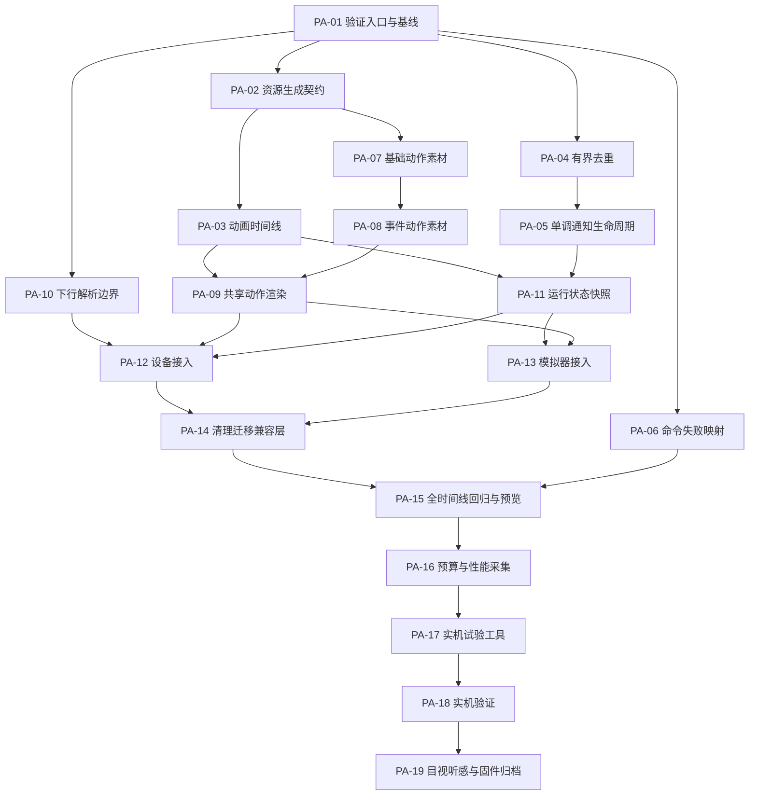

# TASK-026：樱花桌宠动作系统

- **日期**：2026-11-07
- **输入规范**：[SPEC-011](../specs/011-pet-action-system.md)，协议/过滤/硬件边界沿用其关联规范。
- **状态**：任务已拆分，待实施；本次提交不包含实现、素材生成或烧录。
- **基线**：动作规范提交 `e09b620`；以下全部任务初始未完成，不继承旧页面或视频实验的验收结论。
- **编号**：PA-01..PA-19 为 TASK-026 内部编号，避免与现有 TASK-001..025 混淆。

## 实施顺序与检查点

先验证共享时间线和有界调度，再交付可预览的动作素材；模拟器与设备共用逻辑，最后做性能和实物验收。每个任务单独提交，提交说明引用任务编号。预计每项涉及 1..5 个源码/文档文件；动作源文件用单动作图集加描述表组织，避免一个任务堆入几十个散帧文件。



| 检查点 | 任务范围 | 放行条件 |
| :--- | :--- | :--- |
| C1：基础契约 | PA-01..03 | 基线可复现，资源校验失败能拒绝，时间线可确定性采样 |
| C2：事件语义 | PA-04..06 | 重投不重播、倒计时不受校时影响、普通失败变 medium/sigh |
| C3：美术与渲染 | PA-07..09 | 查看原角色对照、七状态接触表和关键帧；确认角色身份和关键姿态后接入设备，完整时间线由 PA-15 验收 |
| C4：两端接入 | PA-10..12，再完成 PA-13 | 下行坏消息不破坏状态；设备构建通过；模拟器通过同一状态序列 |
| C5：软件准入 | PA-14..17 | 全矩阵、素材/应用预算和试验工具异常恢复测试通过，才可执行实机任务 |
| C6：物理交付 | PA-18..19 | 60s 性能、30min 联网、用户目视听感、可核验固件归档分别有证据 |

PA-04..06 与素材工作在接口明确后可独立开展；共用生成器、渲染器和主循环的变更须依次集成。本任务表不要求启动并行代理。任何检查点失败，只修复对应任务，不能通过降低验收要求直接勾选完成。

## 验证命令约定

全部命令在仓库根目录执行。宿主需要 C99 编译器、Python、Pillow；CLI 测试使用已有 Python 测试环境；设备构建使用已安装的 ESP-IDF 5.1.x。**本次只运行文档检查**，下列实现验证由对应任务执行并记录结果。

已有入口（PA-01 起逐步扩展同一 UI 脚本，测试失败须非零退出）：

```sh
python3 tools/test_sakura_ui.py --cc cc --sanitize
make -C firmware/sim test_build
SDL_VIDEODRIVER=dummy firmware/sim/desk_sprite_sim --standalone --once --mode coding
python3 -m pytest tests/cli/test_run_barrier.py tests/cli/test_notify.py -v
. /Users/liruoxuan/esp/esp-idf/export.sh
idf.py -C firmware build
idf.py -C firmware size
git diff --check
```

新测试、描述表、脚本、命令参数和输出报告在下面所属任务完成后才存在。不能在规划提交中创建占位程序或把“命令拟定”写成“验证通过”。脚本编译器设置沿用 `--cc cc --sanitize`，为新 C 测试配置实际依赖源文件，不把业务代码拷贝进测试。

## 任务明细

### PA-01：建立动作验证入口与同配置基线

- [ ] **输入/依赖**：SPEC-011 §5、§7；无前置任务。
- **交付物/文件（3）**：扩展 `tools/test_sakura_ui.py` 编译运行现有调度与触摸动作回归；新增 `docs/validation/pet-actions/baseline.md`，在 `firmware/sim/README.md` 记录入口和前置环境。
- **约束**：保留原有十状态测试；不改变产品行为；构建产物、原始日志存忽略目录。完整固件记录 Git SHA、配置摘要、工具链版本、应用字节数及静态 RAM，后续内存对比采用相同配置；基线报告内附固定字段的 JSON 数据块供预算工具读取。运行期峰值对比由 PA-18 对基线与新应用使用相同统计方法测量。
- **验收**：原 UI、调度及可用触摸软件测试都能从一个入口执行；缺依赖明确失败；基线数值来自实际命令而非旧报告。
- **验证**：`python3 tools/test_sakura_ui.py --cc cc --sanitize`；导出 ESP-IDF 环境后执行 `idf.py -C firmware build`、`idf.py -C firmware size`，保存输出。

### PA-02：定义可校验的动作资源描述与生成结果

- [ ] **输入/依赖**：SPEC-011 §2、§5.2；PA-01。
- **交付物/文件（5）**：`assets/concepts/sakura-green/actions/manifest.json`、同目录 `README.md`；扩展 `tools/generate_sakura_assets.py`；新增 `tests/tools/test_pet_assets.py`；生成 `firmware/src/ui/assets/sakura_actions.h`。
- **约束**：先用原始 idle 资源建立可用链路，其余动作明确尚未提供；禁止假帧冒充完成。描述图集切片、锚点、帧时长、入场/循环/收势和安静变体；源 PNG 可位于原目录，以引用复用。
- **验收**：越界切片、坏索引、零时长、遮罩尺寸错误及超预算均拒绝；生成确定且报告真实二进制字节数，可导出角色接触表；设备端无 PNG/JSON 解码。新增 `--actions-output` 指定动作头文件输出路径，便于素材任务在忽略目录验证。
- **验证**：`python3 -m unittest discover -s tests/tools -p 'test_pet_assets.py' -v`；`python3 tools/generate_sakura_assets.py --font firmware/build/sakura-font/NotoSansSC.ttf`；再跑现有 UI 命令。字体按现有资源说明准备，不重新下载或提交私有文件。

### PA-03：实现可确定采样的动作时间线

- [ ] **输入/依赖**：SPEC-011 §2.1、§4、§5.1；PA-02。
- **交付物/文件（4）**：新增 `firmware/src/include/pet_animator.h`、`firmware/src/engine/pet_animator.c`、`firmware/tests/test_pet_animator.c`；接入 `tools/test_sakura_ui.py`。
- **约束**：64 位单调毫秒；显式动作身份/开始时刻；采样无副作用，不访问 HAL、不播放声音、不维护通知队列。资源未就绪的动作安全回退 idle。
- **验收**：同输入同时间得到同帧；一次性入场只播一次并保持收势；125ms 边界、循环边界、长时间跳跃、相同模式重投和资源异常都有测试。
- **验证**：`python3 tools/test_sakura_ui.py --cc cc --sanitize`；检查新增测试实际被编译执行，C1 才可通过。

### PA-04：在唯一通知调度器内补齐有界去重

- [ ] **输入/依赖**：SPEC-011 §4.1、§4.3；PA-01。
- **交付物/文件（3）**：`firmware/src/include/alert_queue.h`、`firmware/src/engine/alert_queue.c`、`firmware/tests/test_alert_scheduler.c`。
- **约束**：覆盖当前项、等待项、已完成/已丢弃历史；历史最多 32 项、300s、满时淘汰最老项，使用单调时钟；先以显式可注入时间接口实现，迁移期间保留旧调用的兼容入口。
- **验收**：同 ID 改内容仍不替换、不重播；抢占/挤出/过滤的有效事件也进入历史；第 33 项、到期和重启初始化的行为可验证，容量仍为 5 条等待项。
- **验证**：`python3 tools/test_sakura_ui.py --cc cc --sanitize`；使用固定时间推进验证，不实际等待 300s。

### PA-05：把通知展示周期迁移到单调截止时间

- [ ] **输入/依赖**：SPEC-011 §4.2..4.3；PA-04。
- **交付物/文件（3）**：`alert_queue.h`、`alert_queue.c`、`test_alert_scheduler.c`（均为上项同路径）。
- **约束**：新增带单调毫秒和 Unix 秒的显式接口，区分展示超时与准入/出队有效期；旧入口暂保留编译兼容，待 PA-12/13 迁移所有产品调用后删除。不得把 Unix 秒转换成“单调时间”。
- **验收**：medium 从展示起点计 3/8/60s，停顿后直接超时；high 永不自动关闭；模式切换清队列、出队复核、SNTP 跳时符合规范。
- **验证**：`python3 tools/test_sakura_ui.py --cc cc --sanitize`；`make -C firmware/sim test_build`。补充同一秒内开始展示、跨多秒停顿和入场结束但通知未到期的用例。

### PA-06：修正命令普通失败的事件映射

- [ ] **输入/依赖**：SPEC-011 §3.2；PA-01。现有 `run.py` 非零退出为 high，需改为 medium。
- **交付物/文件（3）**：`cli/sprite/commands/run.py`、`tests/cli/test_run_barrier.py`、`specs/004-mac-cli-and-daemon.md`（补动作映射交叉引用）。
- **约束**：成功 medium/cheer/ding；普通失败 medium/sigh/sigh；显式 notify high 保留。子进程退出码、信号转发、TTY 屏障和通知 3s 超时不变。
- **验收**：捕获实际通知参数验证成功/普通失败；126/127 和信号退出仍准确透传；通知失败不能覆盖命令结果。
- **验证**：`python3 -m pytest tests/cli/test_run_barrier.py tests/cli/test_notify.py -v`；不发送真实通知。C2 检查覆盖 PA-04..06。

### PA-07：交付工作、会议、睡眠的真实角色姿态

- [ ] **输入/依赖**：SPEC-011 §2；PA-02。沿用原 idle 两帧。
- **交付物/文件（5）**：动作目录下 `coding.png`、`meeting.png`、`sleep.png` 三张图集，更新同目录 `manifest.json` 与 `README.md`。
- **约束**：分别达到 4/2/3 独立姿态，会议可引用适合的已有姿态；保留角色身份与锚点，帧数上限包括后续事件动作。预览写入忽略目录，生成 C 资源由 PA-09 统一更新。
- **验收**：工作有敲击和抬眼，会议无打字，睡眠有放松姿势；不是单纯平移原图；通过生成器资源验证并检查原尺寸可读性。
- **验证**：`python3 -m unittest discover -s tests/tools -p 'test_pet_assets.py' -v`；执行 `python3 tools/generate_sakura_assets.py --font firmware/build/sakura-font/NotoSansSC.ttf --actions-output firmware/build/sakura-preview/sakura_actions.h`（PA-02 新增参数）；检查输出角色接触表（PA-02 生成器应支持），人工逐帧检查轮廓和透明边。

### PA-08：交付开心、叹气、警觉的真实角色姿态

- [ ] **输入/依赖**：SPEC-011 §2；PA-07，沿用其角色比例和资源契约。
- **交付物/文件（5）**：动作目录下 `cheer.png`、`sigh.png`、`alert.png` 三张图集，更新 `manifest.json` 与 `README.md`。
- **约束**：至少 6/4/4 独立姿态；图集中包含会议安静变体引用，警觉姿态需兼容 high 的紧凑区域；最多 48 姿态、总素材 ≤1MiB。
- **验收**：完整微蹲/举手/落地、肩沉/呼气、抬头/观察可辨认；会议变体不跳；缩到实屏尺寸仍能区分且不靠文字或星光提示。
- **验证**：资源 unittest 与生成器命令同 PA-07；逐帧并排检查原角色与新增姿态，记录美术未确认项。

### PA-09：把动作快照接入共享条带渲染器

- [ ] **输入/依赖**：SPEC-011 §2.2、§5.1；PA-03、PA-08。
- **交付物/文件（5）**：`ui_sakura.h`、`ui_sakura.c`（位于既有 include/ui 目录）、`firmware/tests/test_sakura_ui.c`、生成的 `sakura_actions.h`、`tools/test_sakura_ui.py`。
- **约束**：渲染入口在整帧开始采样/冻结一次，兼容旧调用直到两端迁移；15 个 strip 共用快照，不变更两个 7680 字节缓冲，不引入完整帧缓冲。
- **验收**：基础/medium/high 均绘制真实动作；high 的角色/文案分区与会议静音变体正确；所有关键帧无遮字、越界，资源缺失不隐藏通知。
- **验证**：`python3 tools/test_sakura_ui.py --cc cc --sanitize`；导出七状态接触表及各关键帧检查坐标。C3 需展示原角色对照，美术待确认则不宣称 C3 完成；完整动画由 PA-15 导出。

### PA-10：提取并验证设备下行解析边界

- [ ] **输入/依赖**：SPEC-011 §3；PA-01。
- **交付物/文件（5）**：新增 `firmware/src/include/pet_downlink.h`、`firmware/src/engine/pet_downlink.c`、`firmware/tests/test_pet_downlink.c`；扩展 `tools/test_sakura_ui.py`，在 `firmware/main/CMakeLists.txt` 登记模块。
- **约束**：复用 ESP-IDF 已有 cJSON 源码，不增加运行时依赖；解析失败返回明确状态，不能先改全局模式。本任务只建立可独立测试的解析模块；设备替换调用由 PA-12 完成，保持每次提交可编译。
- **验收**：合法原协议示例、UTF-8 长度、2048 字节限制、缺字段/坏优先级拒绝；未知动作安全降级且 high 不隐藏；未知模式保留最后合法值。
- **验证**：新增参数后执行 `python3 tools/test_sakura_ui.py --cc cc --sanitize --device-parsers --idf-path /Users/liruoxuan/esp/esp-idf`；用该目录 `components/json/cJSON/cJSON` 内的源/头文件编译真实解析器，缺路径明确失败；不用测试替身解析 JSON。

### PA-11：建立可测试的运行状态与整帧快照

- [ ] **输入/依赖**：SPEC-011 §4、§5.1；PA-03、PA-05。
- **交付物/文件（4）**：新增 `firmware/src/include/pet_runtime.h`、`firmware/src/engine/pet_runtime.c`、`firmware/tests/test_pet_runtime.c`；接入 `tools/test_sakura_ui.py`。
- **约束**：在已有调度器上封装基础模式/动作起点和场景快照，不另建通知队列。文案、额度及通知拷入有界快照，不能留指向回调临时内存的指针。
- **验收**：重复模式不重新入场；高优先级打断后恢复最新模式；排队通知未展示不动/不发声，快照创建后改变源状态不影响本帧。
- **验证**：`python3 tools/test_sakura_ui.py --cc cc --sanitize`；固定事件序列包括 coding→cheer→high→sleep→确认，以及 medium 等待中切 meeting。

### PA-12：串行化设备状态并接入动作循环

- [ ] **输入/依赖**：SPEC-011 §4..5；PA-09、PA-10、PA-11。
- **交付物/文件（4）**：`firmware/main/main.c`、`firmware/main/CMakeLists.txt`、`firmware/src/include/touch_action.h`、`firmware/src/engine/touch_action.c`。
- **约束**：统一锁保护 MQTT、UI tick、模式、额度、静音和触摸路径；锁内完成状态变更或快照复制，锁外 flush/音频/网络，避免长时间占锁。沿用原确认语义，触摸默认关闭。
- **验收**：全部设备通知调用使用真实单调时钟；音频只在有效激活/切换时触发且会议立即静音；睡眠背光策略不被临时动作改变，断网不清 high。
- **验证**：UI/解析宿主命令同 PA-10；导出 ESP-IDF 环境后 `idf.py -C firmware build`。编译触摸关闭/开启两种配置验证接口，开启配置只用于编译，不能烧入设备或宣称触摸通过。

### PA-13：模拟器使用相同生命周期和线程快照

- [ ] **输入/依赖**：SPEC-011 §5.1、§7；PA-09、PA-11。
- **交付物/文件（5）**：`firmware/sim/main.c`、`sim_mqtt.c`、`Makefile`、`README.md`；`tools/test_sakura_ui.py`（加入演示事件序列入口的验证）。
- **约束**：MQTT 回调与显示循环按同一锁规则；使用宿主单调时钟；移除模拟器旧计次倒计时调用，两端迁移后由 PA-14 删除临时兼容接口，回归触摸调用。
- **验收**：四模式/通知临时动作显示正确；演示额度明确标注；新增 `--action-demo` 使用真实调度器执行固定事件序列且可通过 `--once` 有界退出，不能另写假动画。
- **验证**：`make -C firmware/sim test_build`；`SDL_VIDEODRIVER=dummy firmware/sim/desk_sprite_sim --standalone --once --action-demo`（本任务新增参数）；现有 `--mode coding` 命令仍可运行。C4 检查两端源列表已包含所有新模块。

### PA-14：移除迁移期间的旧调度调用入口

- [ ] **输入/依赖**：SPEC-011 §4.3；PA-12、PA-13，所有产品调用已迁移。
- **交付物/文件（4）**：`firmware/src/include/alert_queue.h`、`firmware/src/engine/alert_queue.c`、`firmware/tests/test_alert_scheduler.c`、`tools/test_sakura_ui.py`。
- **约束**：删除 PA-04/05 的临时旧时钟包装接口，修正宿主测试调用；不得删除仍使用的确认或队列接口，不通过移除断言隐藏失败。
- **验收**：设备、模拟器及触摸路径均无旧时钟调用；所有超时与去重入口显式区分单调时间和 Unix 时间；固件、模拟器及宿主构建保持通过。
- **验证**：完整宿主命令同 PA-10；`make -C firmware/sim test_build`；IDF 构建。用 `rg -n 'alert_scheduler_(push|tick|dismiss)' firmware` 检查每个调用点，记录接口迁移清单。

### PA-15：导出全部时间线并跑跨模式回归

- [ ] **输入/依赖**：SPEC-011 §7.1..7.3；PA-06、PA-14。
- **交付物/文件（5）**：`firmware/sim/sakura_export.c`、`tools/test_sakura_ui.py`、`firmware/tests/test_pet_runtime.c`、`test_sakura_ui.c`、`docs/validation/pet-actions/software.md`。
- **约束**：预览来自设备共用 C 渲染器；PNG 为真实 240×240，GIF/视频包含全部阶段并标记动作 ID/时间。已有 idle.gif 不可冒充完整时间线；Pillow 缺失时视觉验收失败，不能只输出 PPM 后声称齐全。
- **验收**：覆盖 4 模式×3 优先级×7 动作，3/8/60s、抢占/出队/重投/时钟/异常资源；条带中间改变输入仍同帧一致；原额度语义、时钟和连接标识回归通过。
- **验证**：运行 PA-10 的完整宿主命令、CLI 测试、`make -C firmware/sim test_build`；检查忽略目录中七状态关键帧、GIF 和接触表，软件报告仅写已执行项。

### PA-16：加入资源门槛与低开销性能统计

- [ ] **输入/依赖**：SPEC-011 §5.2；PA-15。
- **交付物/文件（5）**：新增 `tools/check_pet_action_budget.py`、`tests/tools/test_pet_action_budget.py`；更新 `firmware/main/main.c`、`tools/test_sakura_ui.py`、`docs/validation/pet-actions/software.md`。
- **约束**：统计实测帧开始/完成、render+flush 耗时分布、峰值/最小堆及错误；不逐帧打印或动态扩容样本。预算脚本以 ELF/镜像/生成资源实际字节为输入，不以 C 头文件文本长度计量。在软件报告写明对 `e09b620` 基线应用加入同一统计逻辑的重建步骤：仅加入统计、不移植新动作或调度器，保持相同配置和采样容量；最小仪表补丁与镜像存忽略目录，PA-18 据此比较运行期内存。
- **验收**：新增只读≤1MiB、姿态≤48、应用≤2.75MiB、静态/峰值新增可写≤16KiB；静态项与 PA-01 同配置比较；运行期内存差值及 FPS/P95 留到 PA-18 测量，软件预算脚本不能把未测的运行期峰值判为通过。
- **验证**：`python3 -m unittest discover -s tests/tools -p 'test_pet_action_budget.py' -v`；IDF 构建后执行拟新增命令 `python3 tools/check_pet_action_budget.py --build firmware/build --baseline docs/validation/pet-actions/baseline.md`；超限返回非零并指出项。

### PA-17：准备仅替换应用区的可恢复实机试验

- [ ] **输入/依赖**：SPEC-011 §7，SPEC-009 设备身份/备份要求；PA-16。参考视频试验的备份机制，不能原样运行会播放 AVI 的脚本。
- **交付物/文件（3）**：新增 `tools/run_pet_action_trial.py`、`tests/tools/test_pet_action_trial.py`、`docs/validation/pet-actions/device-runbook.md`。
- **约束**：当前实际串口通过 `--port` 显式输入；核对 MAC、3MiB 应用分区和镜像；读满8MiB并设备端摘要验证，只写/校验 `0x10000` 应用区。备份和原始日志目录0700、文件0600，不改 NVS/bootloader。
- **验收**：刷写失败、启动失败、中断及网络恢复失败均有模拟测试；默认试验结束恢复原应用并校验启动/MQTT，释放 DTR、关闭串口；主机掉电无法自动恢复时有可执行手动恢复步骤。
- **验证**：`python3 -m unittest discover -s tests/tools -p 'test_pet_action_trial.py' -v`；`python3 tools/run_pet_action_trial.py --help`。runbook 必须在 C5 前写明真实 IDF Python、串口枚举、备份/写入/回滚命令和通知注入方式；本任务测试使用替身端口，禁止碰设备。

### PA-18：执行性能、联网与异常实机验证

- [ ] **输入/依赖**：C3/C5 通过；PA-17 runbook；执行时具备设备操作授权及可用实体板卡。
- **交付物/文件（1）**：`docs/validation/pet-actions/device.md`；完整备份、构建副本、串口日志、测量 JSON 放忽略的 `.local/pet-action-trial/`。
- **约束**：使用 PA-17 工具指定实际端口，例如 `python3 tools/run_pet_action_trial.py --port /dev/cu.ACTUAL --build firmware/build --output .local/pet-action-trial/run-01`；`/dev/cu.ACTUAL` 是必须替换的占位符，不得猜测旧端口。通知使用现有受认证入口，凭据从本地配置读取，不出现在命令参数/报告。high 测试使用既有测试确认通路，不能新增自动确认。
- **验收**：以相同仪表和配置对基线/新应用测新增可写峰值≤16KiB；活跃动画60s平均≥7FPS、render+flush P95≤125ms；30min联网无持续堆下降/复位/失联；逐项验证重投、抢占、会议静音、sleep过滤与high、断线重连及恢复原应用。
- **验证**：严格执行 runbook，把事件 ID、采样时长、帧数、P95、堆曲线与回滚校验写入去敏报告；缺板卡/无授权/缺观察只能标记未执行，不得用模拟器结果替代。

### PA-19：用户目视听感验收与固件归档

- [ ] **输入/依赖**：SPEC-011 §7.3；PA-18 通过且具备实物观察条件。
- **交付物/文件（4）**：完善 `device.md`，新增 `docs/validation/pet-actions/release.md`；更新 `README.md` 与 `specs/011-pet-action-system.md` 的实际状态。固件存 `.local/firmware-archives/`，不提交二进制或设备备份。
- **约束**：向用户展示原尺寸时间线，实屏检查轮廓、裁边、节奏、文字、音效和会议静音；触摸仍标记独立未验收。只有明确取得安装授权才把应用留在设备，默认试验结束恢复原固件。
- **验收**：记录用户对角色动作和声音的明确反馈；归档应用 bin、ELF、map、分区表、去敏配置、构建工具版本、Git SHA与SHA256清单；排除NVS、密码和全片备份，写明镜像是否已安装。
- **验证**：在归档目录执行 `shasum -a 256 -c SHA256SUMS`；从源码按 release 记录重建并检查预算（不要求含编译时间的镜像逐字节相同）；`git diff --check`。仅当代码测试、实机测试、用户确认分别完成，才把 TASK-026 标为完成。

## 规范覆盖与风险

| SPEC-011 要求 | 负责的任务 |
| :--- | :--- |
| §1..2 六类动作、会议、原角色和布局 | PA-02/03/07/08/09/15/19 |
| §3 协议复用、成功失败映射、非法输入降级 | PA-06/10/12/13 |
| §4 过滤、队列、去重、打断恢复、时钟、断网 | PA-04/05/11/12/13/14/15/18 |
| §5 共用 C、整帧快照、内存/Flash/刷新预算 | PA-01/02/03/09/11/12/13/16/18 |
| §6 位置与风格 | 各源码任务按既有路径；新增 runtime/downlink 模块只负责已有契约，不增加外部接口 |
| §7 软件/物理验收 | PA-01/14/15/16/17/18/19 |
| §8 触摸、凭据、改协议/硬件等边界 | 所有任务，PA-12/17/19 专项检查 |

| 风险 | 处理方式 |
| :--- | :--- |
| 新素材只有装饰变化或角色走样 | C3 人工看真实姿态与原角色对照；不满意先改素材，再接设备 |
| 当前调度按调用次数减秒、回调直接改状态 | PA-05 引入显式单调时间，PA-11/12/13 固定状态所有权；PA-14 在两端迁移后清除兼容层 |
| main.c 修改过多或单项超过5个逻辑文件 | 在执行前按解析/时钟/快照调用点继续拆子任务，保持每次构建可用，不能顺带重构驱动 |
| 凭据导致构建/日志/固件归档污染 | 只用 NVS 与本地配置，归档检查去敏配置；完整备份/原始日志留忽略目录 |
| Flash、RAM或帧率不达标 | 先减少冗余姿态/拷贝；保持验收门槛，不自动扩分区、开PSRAM或改SPI引脚 |
| GPIO5触摸未校准，high缺物理确认链路 | 保持默认关闭，仅以既有测试确认通路做软件验证，报告明确物理链路未完成 |

本轮范围到任务文档提交推送；各任务按后续实施指令执行。计划内的美术确认、实机准入和最终用户反馈是对应阶段的验证条件，不阻塞本次任务拆分交付。
