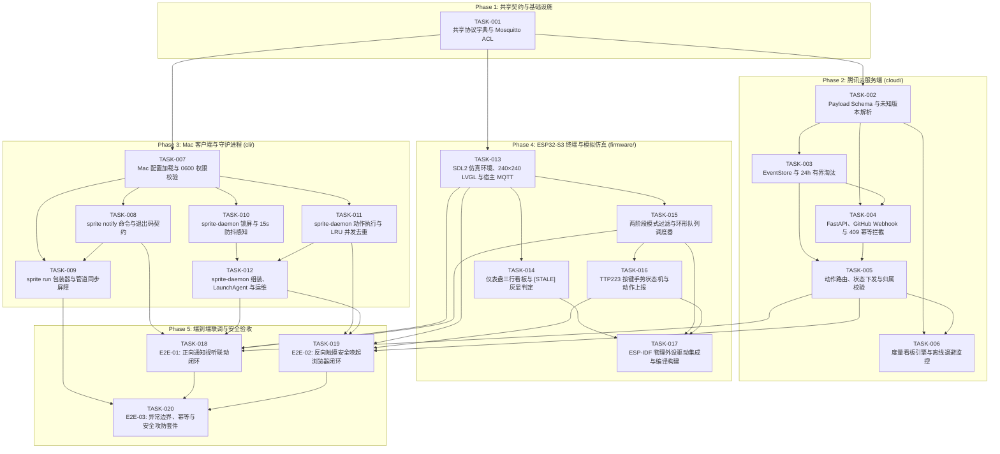

# Desk Sprite (desk-sprite) — 开发任务拆解 (Task Breakdown)

- **版本**: 1.1.0
- **日期**: 2026-11-02
- **依据规范**: [SPEC-001](../specs/001-system-architecture.md) (v1.4.0), [SPEC-002](../specs/002-protocol-and-events.md) (v1.4.0), [SPEC-003](../specs/003-sprite-display-and-state-machine.md) (v1.4.0), [SPEC-004](../specs/004-mac-cli-and-daemon.md) (v1.4.0), [AGENTS.md](../AGENTS.md)
- **执行原则**: 规范驱动开发 (SDD)、原子化交付、安全第一、闭环验证。

---

## 任务依赖全景图 (Dependency Graph)

---

## 阶段一：共享契约与基础设施 (Shared Foundation)

### TASK-001: 共享协议数据字典与 Mosquitto ACL 规则配置
- **模块归属**: `cloud/deploy/`, `shared/`
- **依赖任务**: 无
- **输入**: [SPEC-001](../specs/001-system-architecture.md), [SPEC-002](../specs/002-protocol-and-events.md) 第 1 节
- **交付物**:
  - `shared/enums.py`: 统一枚举基准定义（`priority`, `sound`, `pet_action`, `work_mode`）。
  - `cloud/deploy/mosquitto/mosquitto.conf`: 基础 MQTT 服务端配置。
  - `cloud/deploy/mosquitto/acl.conf`: 严格 Topic ACL 隔离配置文件。
  - `cloud/deploy/mosquitto/generate_acl.py`: 基于设备配置动态生成无前缀 `host_id` / `device_id` 鉴权条目的工具脚本。
- **技术约束**:
  - 标识符命名规范：纯字符串，严禁二次拼接 `host_host_` 或 `dev_dev_`；
  - Mosquitto ACL 限制：`cloud_admin` 拥有全 Topic 权限；`host_{id}` 仅限读 `sprite/host/{id}/down/#`，写 `sprite/host/{id}/up/#`；`dev_{id}` 仅限读 `sprite/device/{id}/down/#`，写 `sprite/device/{id}/up/#`；
- **可执行验证命令**:
  - `python3 cloud/deploy/mosquitto/generate_acl.py --test`
  - 使用 Mosquitto 命令行客户端验证：以 `dev_esp32_c049ef` 身份发布至 `sprite/device/esp32_other/up/action`，验证被 Broker 拒绝且 Broker 日志记录 `Access Denied`。

---

## 阶段二：腾讯云服务端 (Cloud Hub & Event Engine)

### TASK-002: 云端 Payload Schema 与健壮性解析验证器
- **模块归属**: `cloud/app/schemas/`
- **依赖任务**: TASK-001
- **输入**: [SPEC-002](../specs/002-protocol-and-events.md) 第 2 & 3 节
- **交付物**:
  - `cloud/app/schemas/base.py`: 基础 Envelope 模型（**仅包含** 全局共有字段 `type: str`, `version: int = 1`，避免在基类强加特定时间字段）。
  - `cloud/app/schemas/metrics.py`: 度量看板下发 Schema（含 `timestamp: int`, `bars` 约束与 `direction` 枚举）。
  - `cloud/app/schemas/alert.py`: 即时通知下发 Schema（含 `timestamp: int`, `expire_at: int`, `title`, `summary`, `priority`, `interactive` 等严格字段限制）。
  - `cloud/app/schemas/state.py`: 工作状态同步 Schema（`host_state_update` 与 `state_sync`，均含 `timestamp: int`, `data.work_mode`）。
  - `cloud/app/schemas/device_action.py`: 终端按键动作上报 Schema（含 `created_at: int`, UUIDv4 `action_id`, `expire_at` 严格等于 `created_at + 10`，绝不增加多余必填 `timestamp`）。
  - `cloud/app/schemas/host_command.py`: Mac 宿主指令 Schema（含 `created_at: int`, `expire_at: int`, `command_id`, `action="open_browser"`, `params.url`，绝不增加多余必填 `timestamp`）。
  - `cloud/app/schemas/command_ack.py`: 执行回执 Schema（含 `timestamp: int`, `status`, `error_code`）。
  - `cloud/app/schemas/status.py`: 在线生命周期 Schema（含 `timestamp: int`, `status`）。
  - `tests/cloud/test_schemas.py`: 字段边界与版本兼容测试。
- **技术约束**:
  - 基于 Pydantic v2 实现；
  - **未知版本兼容处理**: 当收到 `version > 1` 的 JSON 消息时，必须对已知字段进行尽力解析，未知字段安全忽略，严禁崩溃报错抛异常；
  - 字段长度限制：`title` 1~24 字符，`summary` 1~48 字符，`bars` 数组 1~3 元素，`limit > 0`；
  - **Spec 原样示例兼容**: 确保 SPEC-002 中 `device_action` 与 `host_command` 的原样 JSON 无需补充 `timestamp` 即可完全通过验证；缺少各自规定的 `created_at` 则必须报错拦截。
- **可执行验证命令**:
  - `pytest tests/cloud/test_schemas.py -v`

### TASK-003: 云端事件状态存储 (EventStore) 与有界淘汰机制
- **模块归属**: `cloud/app/services/`
- **依赖任务**: TASK-002
- **输入**: [SPEC-002](../specs/002-protocol-and-events.md) 第 4 节
- **交付物**:
  - `cloud/app/services/event_store.py`: 内存/线程安全事件记录存储引擎。
  - `tests/cloud/test_event_store.py`: 有界 TTL 与淘汰机制单测。
- **技术约束**:
  - 存储字段：`event_id`, `target_device`, `target_host`, `target_url`, `is_interactive`, `created_at`, `state` (`pending` | `consumed` | `expired`)；
  - 淘汰策略：普通 Medium 告警保留 10 分钟；High 告警无论设备是否关闭，保留上限严格设为 24 小时 (24h TTL)；
  - 超过 24 小时后记录自动清理；已淘汰事件被按键上报时判定为未知事件，仅消除弹窗，绝不派发 `host_command`。
- **可执行验证命令**:
  - `pytest tests/cloud/test_event_store.py -v`

### TASK-004: FastAPI 核心网关、GitHub Webhook 验签与幂等冲突契约
- **模块归属**: `cloud/app/api/`, `cloud/app/services/`
- **依赖任务**: TASK-002, TASK-003
- **输入**: [SPEC-001](../specs/001-system-architecture.md) 第 1.1 & 3.2 节, [SPEC-002](../specs/002-protocol-and-events.md) 第 5 节
- **交付物**:
  - `cloud/app/main.py`: FastAPI 应用程序入口与统一异常处理中间件。
  - `cloud/app/api/v1/notify.py`: `POST /api/v1/notify` 接口实现。
  - `cloud/app/api/v1/webhook.py`: `POST /api/v1/webhook/github` 接口实现。
  - `cloud/app/services/webhook_verifier.py`: GitHub Webhook HMAC sha256 签名校验器（`X-Hub-Signature-256`）与事件到通知模型转换器。
  - `cloud/app/services/idempotency.py`: 5 分钟幂等键管理器（`owner_id:idempotency_key`）。
  - `tests/cloud/test_notify_api.py`: 状态码分类与幂等契约单元测试。
  - `tests/cloud/test_webhook_api.py`: GitHub Webhook HMAC 验签（正常、伪造、缺失）与事件转换单元测试。
- **技术约束**:
  - 统一响应格式：`{"code": 0, "message": "success", "data": ...}`；
  - 错误码严格映射：400 (`40001`), 401 (`40101`, 包含 API Token 无效与 Webhook HMAC 签名失败), 403 (`40301`, 越权防护), 404 (`40401`), 409 (`40901`, 幂等冲突), 422 (`42201`)；
  - **幂等处理规则**: 相同 Key + 相同 Body 返回 200 与原 `event_id`（不重复生成与下发）；相同 Key + 不同 Body 严格返回 HTTP 409 Conflict (`code: 40901`)；
  - **GitHub Webhook 验签契约**:
    - 读取请求头 `X-Hub-Signature-256` 与服务端配置的 `GITHUB_WEBHOOK_SECRET`；
    - 使用 `hmac.compare_digest` 进行常量时间比对；
    - 签名缺失或错误立即返回 HTTP 401 (`code: 40101`)，绝不进入存储与 MQTT 下发链路；
    - 校验通过后，解析 GitHub Webhook Payload（如 PR 或 Workflow 状态），转换为规范的 `alert` 结构存入 `EventStore` 并下发至绑定的 `target_device`。
- **可执行验证命令**:
  - `pytest tests/cloud/test_notify_api.py -v`
  - `pytest tests/cloud/test_webhook_api.py -v`

### TASK-005: 动作路由流水线、工作状态下发转发与归属校验
- **模块归属**: `cloud/app/services/`
- **依赖任务**: TASK-003, TASK-004
- **输入**: [SPEC-001](../specs/001-system-architecture.md) 3.2 节, [SPEC-002](../specs/002-protocol-and-events.md) 1.2, 3.3 & 4 节
- **交付物**:
  - `cloud/app/services/action_router.py`: 动作路由与安全归属校验器。
  - `cloud/app/services/state_forwarder.py`: 宿主工作状态接收与定向转发器。
  - `cloud/app/services/mqtt_service.py`: MQTT 消息监听、路由与下发服务。
  - `tests/cloud/test_action_router.py`: 跨设备冒名拦截与哈希命令单测。
  - `tests/cloud/test_state_forwarder.py`: 宿主工作状态同步转发与设备隔离单测。
- **技术约束**:
  - **终端物理动作路由链路**:
    - 订阅 `sprite/device/+/up/action`；以 Topic 提取的 `src_dev` 为唯一受信实体 ID；
    - 强校验：Payload 中 `device_id` 必须与 `src_dev` 一致，不一致直接丢弃并记安全告警；
    - 归属校验：检索 EventStore，若 `record.target_device != src_dev`，判定为跨设备冒名伪造，立即安全拦截并写审计日志；
    - 交互判定：`is_interactive == true` 且 URL 存在时才生成命令；
    - 确定性命令 ID：严格依据公式生成 `command_id = "cmd_" + sha256(action_id)[:16]`；
    - 10 分钟内存去重缓存，防止重复向 Mac 派发；命令有效期 `expire_at = created_at + 60`；
  - **宿主工作状态转发链路**:
    - 订阅 `sprite/host/+/up/state`；
    - 校验 Topic 提取的 `host_id` 与 Payload 一致性，解析 `host_state_update`；
    - 依据系统静态绑定配置（`host_id` -> `target_device`），组装 `state_sync` 消息（`work_mode` 为 `coding` / `meeting` / `sleep` / `idle`）；
    - 下发至 `sprite/device/{target_device}/down/state` (QoS 1, Retain=True)；
    - 严禁向无关设备广播或转发；
    - 与 TASK-006 离线退避协同（在线时实时同步，离线超时 60s 由生命周期监视器退避至 idle）。
- **可执行验证命令**:
  - `pytest tests/cloud/test_action_router.py -v`
  - `pytest tests/cloud/test_state_forwarder.py -v`

### TASK-006: 度量看板引擎与设备生命周期监控
- **模块归属**: `cloud/app/services/`
- **依赖任务**: TASK-002, TASK-005
- **输入**: [SPEC-001](../specs/001-system-architecture.md) 4 节, [SPEC-002](../specs/002-protocol-and-events.md) 3.1 & 3.7 节
- **交付物**:
  - `cloud/app/services/metrics_engine.py`: 看板数据装配与定时推送（QoS 0, Retain=True）。
  - `cloud/app/services/lifecycle_monitor.py`: LWT 状态监控与退避协调器。
  - `tests/cloud/test_lifecycle.py`: 离线检测与退避单元测试。
- **技术约束**:
  - `bars` 包含 `sampled_at`, `ttl_sec`, `status`, `direction`；
  - 监听 Mac 宿主与 ESP32 的 LWT 遗嘱消息；
  - 当检测到 Mac 离线超过 60 秒，自动向绑定的 ESP32 下发 `work_mode: "idle"`。
- **可执行验证命令**:
  - `pytest tests/cloud/test_lifecycle.py -v`

---

## 阶段三：Mac 客户端与本地守护进程 (cli/)

### TASK-007: Mac 客户端配置与文件权限安全校验
- **模块归属**: `cli/sprite/`
- **依赖任务**: TASK-001
- **输入**: [SPEC-004](../specs/004-mac-cli-and-daemon.md) 4.2 节
- **交付物**:
  - `cli/sprite/config.py`: 统一配置模型与文件读写器。
  - `tests/cli/test_config.py`: 配置文件加载与权限边界测试。
- **技术约束**:
  - 配置路径 `~/.sprite/config.json`；
  - 严格权限校验：目录必须为 `0700`，配置文件必须为 `0600`；若权限过于宽松，必须拒绝执行并报错或自动纠正为 `0600`；
  - 提供默认模板生成能力。
- **可执行验证命令**:
  - `pytest tests/cli/test_config.py -v`

### TASK-008: `sprite notify` 命令行工具实现
- **模块归属**: `cli/sprite/`
- **依赖任务**: TASK-007
- **输入**: [SPEC-004](../specs/004-mac-cli-and-daemon.md) 2.1 节
- **交付物**:
  - `cli/sprite/commands/notify.py`: notify 子命令逻辑。
  - `cli/bin/sprite`: CLI 执行入口脚本。
  - `tests/cli/test_notify.py`: 命令行参数与返回码测试。
- **技术约束**:
  - 参数与 SPEC-002 严格映射：`--level` (`priority`), `--sound` (`sound`), `--mood` (`pet_action`), `--url` (`url`), `--device` (`target_device`)；
  - 严格退出码规范：
    - `0`: 通知成功发送并被云端接收；
    - `1`: 本地配置缺失或参数非法（如枚举值非法）；
    - `2`: 网络不可达或云端鉴权失败 (401 / 403)。
- **可执行验证命令**:
  - `pytest tests/cli/test_notify.py -v`
  - `cli/bin/sprite notify "标题" "内容" --level medium --sound ding`

### TASK-009: `sprite run` 命令包装器与管道同步屏障 (Pipe-based Sync Barrier)
- **模块归属**: `cli/sprite/`
- **依赖任务**: TASK-007, TASK-008
- **输入**: [SPEC-004](../specs/004-mac-cli-and-daemon.md) 2.2 节
- **交付物**:
  - `cli/sprite/commands/run.py`: 包装执行器实现。
  - `tests/cli/test_run_barrier.py`: TTY 同步屏障与非 TTY 透传单测。
- **技术约束**:
  - 控制终端交互环境 (`isatty(STDIN_FILENO) == 1`):
    - `fork()` 前建立带 `O_CLOEXEC` 的单向同步管道 `sync_pipe`；
    - 子进程: `close(sync_pipe[1])` -> `setpgid(0, 0)` -> **阻塞屏障 `read(sync_pipe[0], &token, 1)`** -> 收到放行 token 后 `close(sync_pipe[0])` 并 `execvp`；
    - 父进程: `close(sync_pipe[0])` -> `setpgid(child, child)` -> 忽略 `SIGTTOU` -> 调用 `tcsetpgrp(STDIN, child)` 移交前台控制权 -> **解除屏障 `write(sync_pipe[1], "G", 1)`**；
    - 移交失败兜底: 若 `tcsetpgrp` 失败，向子进程发送 `SIGKILL`，清理退出，绝不遗留挂起进程；
    - 运行结束回收控制权: `tcsetpgrp(STDIN, getpgrp())`；
  - 非终端环境 (`!isatty(STDIN_FILENO)`):
    - 直接透传 FD 0/1/2，不创建管道，不调 `tcsetpgrp`；父进程捕获 `SIGINT`/`SIGTERM` 转发给子进程组；
  - 退出码保持: 正常退出保持相同退出码；信号终止返回 `128 + signum`（SIGINT 为 130）；
  - 通知超时: 命令执行完毕后调用 HTTP 通知，设置 **3.0 秒硬超时**，失败仅向 `stderr` 打印警告，绝不篡改退出码。
- **可执行验证命令**:
  - `pytest tests/cli/test_run_barrier.py -v`
  - 模拟父进程延迟 200ms 放行，子进程执行 `bash -c 'read -p "Input:" var && echo $var'`，验证正常交互且不触发 SIGTTIN；
  - 测试 `cli/bin/sprite run -- cat /etc/hosts | grep "localhost"` 验证流式管道透传。

### TASK-010: `sprite-daemon` macOS 原生锁屏驱动与前台防抖感知
- **模块归属**: `cli/sprite/daemon/`
- **依赖任务**: TASK-007
- **输入**: [SPEC-004](../specs/004-mac-cli-and-daemon.md) 2.3 & 3.1 节
- **交付物**:
  - `cli/sprite/daemon/screen_monitor.py`: 原生锁屏监听（基于 PyObjC / NSDistributedNotificationCenter）。
  - `cli/sprite/daemon/app_monitor.py`: 前台应用 3 秒轮询与 15 秒防抖状态管理器。
  - `cli/sprite/commands/state.py`: `sprite state set` 与 `sprite state auto` 命令行支持。
  - `tests/cli/test_state_monitor.py`: 锁屏瞬时性与 15 秒防抖单测。
- **技术约束**:
  - 锁屏瞬时上报: 监听 `com.apple.screenIsLocked`，500ms 内向 MQTT 上报 `work_mode: "sleep"`；
  - 解锁瞬时刷新: 监听 `com.apple.screenIsUnlocked` 立即触发刷新；
  - 15 秒防抖感知: 仅在非锁屏且未手动覆盖时，每 3 秒检测一次前台应用，连续匹配 15 秒才上报 `coding` / `meeting`；
  - 手动模式覆盖: 支持手动锁定 30 分钟 (TTL 1800s)，或手动 `auto` 提前解除。
- **可执行验证命令**:
  - `pytest tests/cli/test_state_monitor.py -v`

### TASK-011: `sprite-daemon` 反向动作执行器与原子并发去重
- **模块归属**: `cli/sprite/daemon/`
- **依赖任务**: TASK-007
- **输入**: [SPEC-004](../specs/004-mac-cli-and-daemon.md) 3.2 节
- **交付物**:
  - `cli/sprite/daemon/command_executor.py`: 指令原子去重与系统安全调用器。
  - `cli/sprite/daemon/mqtt_worker.py`: 守护进程 MQTT 客户端（订阅 `sprite/host/{host_id}/down/command`，上报 ACK）。
  - `tests/cli/test_command_executor.py`: 并发双开拦截与 URL 校验单测。
- **技术约束**:
  - MQTT 会话契约：固定配置 `clean_session = true`；订阅主题严格为 `sprite/host/{host_id}/down/command`；
  - 原子登记 In-Flight：维护容量 500 的内存 LRU 集合；执行前原子占位；已存在立即返回 ACK `status: "duplicate_ignored"`，严禁调用系统 open；
  - 有效期检查：`now > expire_at` 返回 ACK `status: "expired"`，不调用 open；
  - URL 安全校验：标准解析器校验仅限 http/https，无空格分号，长度 ≤512；
  - 系统调用：通过参数数组调用 `/usr/bin/open`，严禁 Shell 拼接。
- **可执行验证命令**:
  - `pytest tests/cli/test_command_executor.py -v`

### TASK-012: `sprite-daemon` 核心进程组装、LaunchAgent 与运维
- **模块归属**: `cli/bin/`, `cli/deploy/`
- **依赖任务**: TASK-010, TASK-011
- **输入**: [SPEC-004](../specs/004-mac-cli-and-daemon.md) 1, 3 & 4.1 节
- **交付物**:
  - `cli/bin/sprite-daemon`: 守护进程主执行入口，支持 `sprite-daemon run`（常驻主进程）、`sprite-daemon status`、`sprite-daemon stop`，装配 `screen_monitor`、`app_monitor`、`mqtt_worker` 与 `command_executor`。
  - `cli/templates/com.sprite.daemon.plist.template`: LaunchAgent 模版。
  - `cli/scripts/install_daemon.sh`: 动态获取 `$HOME` 绝对路径并安装加载的脚本。
  - `cli/scripts/uninstall_daemon.sh`: 卸载停止脚本。
  - `tests/cli/test_daemon_lifecycle.py`: 守护进程启停、组件组装与信号退出单测。
- **技术约束**:
  - 生成 `~/Library/LaunchAgents/com.sprite.daemon.plist`；
  - 日志绝对路径：标准输出与错误分别输出到 `~/.sprite/daemon.log` 与 `daemon.err`；
  - 权限规范：`~/.sprite` (0700)，日志文件 (0600)；
  - 进程退出契约：捕获 `SIGTERM` / `SIGINT` 时向 MQTT 发送优雅下线状态（`status: "offline"`, `reason: "graceful_shutdown"`）并释放资源。
- **可执行验证命令**:
  - `pytest tests/cli/test_daemon_lifecycle.py -v`
  - `cli/bin/sprite-daemon run --help`
  - `plutil -lint ~/Library/LaunchAgents/com.sprite.daemon.plist`
  - `bash cli/scripts/install_daemon.sh --dry-run`

---

## 阶段四：ESP32-S3 终端与模拟仿真 (firmware/)

### TASK-013: PC/Mac SDL2 仿真环境、240×240 LVGL 骨架与宿主 MQTT 接入适配
- **模块归属**: `firmware/sim/`, `firmware/src/ui/`
- **依赖任务**: TASK-001
- **输入**: [SPEC-001](../specs/001-system-architecture.md) 1.1 节, [SPEC-003](../specs/003-sprite-display-and-state-machine.md) 1 & 2 节
- **交付物**:
  - `firmware/sim/Makefile`: SDL2 模拟器构建工程（与 make 验证命令保持一致）。
  - `firmware/sim/main.c`: 模拟器主循环、SDL2 窗口与按键/鼠标手势映射。
  - `firmware/sim/sim_mqtt.c`, `firmware/sim/sim_mqtt.h`: 宿主机端轻量 MQTT 适配客户端。
  - `firmware/sim/sim_audio.c`: SDL2 音频输出适配与可断言的音频回调事件桩。
  - `firmware/src/ui/ui_layout.c`, `firmware/src/ui/ui_layout.h`: 240×240 布局网格组件（顶部状态栏 24px + 舞台区 144px + 三行看板 72px）。
- **技术约束**:
  - LVGL v8.3.11；严格 240×240 物理视口；舞台居中 `(56, 32)` 渲染 128×128 动效；
  - **宿主机 MQTT 适配**: 启动时以 `dev_{device_id}` 身份接入测试 Mosquitto Broker，订阅 `sprite/device/{device_id}/down/#`（`down/alert`, `down/metrics`, `down/state`），上报在线状态与动作消息；
  - **音频与点击接入**: 收到弹窗时通过 SDL2 播放提示音并生成音频调用断言记录；窗口鼠标点击/长按映射为 TTP223 手势输入；
  - 支持 `--headless-test` 自动化测试模式，能够在 Mac/CI 上独立启动与退出。
- **可执行验证命令**:
  - `cd firmware/sim && make && ./desk_sprite_sim --headless-test`

### TASK-014: 仪表盘三行看板渲染与本地断网 `[STALE]` 判定引擎
- **模块归属**: `firmware/src/ui/`
- **依赖任务**: TASK-013
- **输入**: [SPEC-002](../specs/002-protocol-and-events.md) 3.1 节, [SPEC-003](../specs/003-sprite-display-and-state-machine.md) 2 节
- **交付物**:
  - `firmware/src/ui/ui_metrics.c`, `firmware/src/ui/ui_metrics.h`: 三行指标看板渲染逻辑。
  - `firmware/tests/test_metrics_stale.c`: 本地 Stale 判定单测。
  - `firmware/tests/mocks/mock_time.h`: 宿主机测试时钟替身桩。
- **技术约束**:
  - 支持 1~3 条度量指标；
  - 支持进度方向：`used` (已用比例) 与 `remaining` (剩余比例)；
  - **本地 Stale 判定**: 当 `now - sampled_at > ttl_sec` 时，进度条灰显并标示 `[STALE]`；
  - `is_mock == true` 时渲染 `[M]` 角标；
  - 宿主机测试链接实际实现 `ui_metrics.c` 与时钟替身桩。
- **可执行验证命令**:
  - `mkdir -p firmware/build && gcc -Wall -Wextra -I firmware/src -I firmware/tests firmware/src/ui/ui_metrics.c firmware/tests/test_metrics_stale.c -o firmware/build/test_metrics_stale && ./firmware/build/test_metrics_stale`

### TASK-015: 两阶段告警模式过滤与环形队列调度器
- **模块归属**: `firmware/src/engine/`
- **依赖任务**: TASK-013
- **输入**: [SPEC-003](../specs/003-sprite-display-and-state-machine.md) 3 & 4 节
- **交付物**:
  - `firmware/src/engine/alert_filter.c`, `firmware/src/engine/alert_filter.h`: 阶段 1 入队拦截器。
  - `firmware/src/engine/alert_queue.c`, `firmware/src/engine/alert_queue.h`: 容量为 3 的环形队列调度器。
  - `firmware/tests/test_alert_scheduler.c`: 模式切换与调度复核单元测试。
  - `firmware/tests/mocks/mock_hardware.h`: 功放使能 `PA_EN` 与背光状态替身桩。
- **技术约束**:
  - **阶段 1 (入队过滤)**:
    - 当前为 `sleep` 且告警为 `low` 或 `medium`：在网络层直接丢弃，绝不压入队列，不亮屏幕；
    - 当前为 `meeting` 且告警为 `medium` 或 `high`：标记 `force_mute = true`；
    - 当前为 `coding` / `idle` 且为 `low`：仅状态栏打点 3 秒，不进队；
  - **队列抢占与排队**:
    - High 立即抢占 Medium 弹窗；同 `event_id` High 静默幂等丢弃；新 High 替换旧 High；
  - **阶段 2 (出队复核)**:
    - 弹窗结束拉取新排队项时，以取出瞬间最新 Base Mode 复核；
    - 若最新状态变为 `sleep`：立即清空并丢弃队列中所有 `medium`，恢复休眠；
    - 若最新状态变为 `meeting`：强制保持硬件功放静音（`PA_EN = 0`）；
  - **High 告警豁免**: 正在展示的 High 告警绝不受 `expire_at` 影响，必须等待手动确认消除；
  - 宿主机测试链接实际实现 `alert_filter.c`、`alert_queue.c` 与硬件替身桩。
- **可执行验证命令**:
  - `mkdir -p firmware/build && gcc -Wall -Wextra -I firmware/src -I firmware/tests firmware/src/engine/alert_filter.c firmware/src/engine/alert_queue.c firmware/tests/test_alert_scheduler.c -o firmware/build/test_alert_scheduler && ./firmware/build/test_alert_scheduler`

### TASK-016: TTP223 触摸手势状态机与动作上报契约
- **模块归属**: `firmware/src/hal/`, `firmware/src/engine/`
- **依赖任务**: TASK-015
- **输入**: [SPEC-002](../specs/002-protocol-and-events.md) 3.4 节, [SPEC-003](../specs/003-sprite-display-and-state-machine.md) 6 节
- **交付物**:
  - `firmware/src/hal/touch_button.c`, `firmware/src/hal/touch_button.h`: 高电平脉冲防抖与手势判定（单击 50~300ms，长按 ≥1200ms）。
  - `firmware/src/engine/action_reporter.c`, `firmware/src/engine/action_reporter.h`: 动作 JSON 组装与上报封装。
  - `firmware/tests/test_touch_gestures.c`: 手势状态机单元测试。
  - `firmware/tests/mocks/mock_mqtt.h`: 动作上报 MQTT 替身桩。
- **技术约束**:
  - 弹窗状态下单按 (Tap): 立即本地关闭弹窗，生成标准 UUIDv4 `action_id`，设置 `expire_at = created_at + 10`，携带当前 `active_alert_id` 发布至 `sprite/device/{id}/up/action`；
  - 弹窗状态下长按 (Long Press): 静默关闭弹窗，不上报动作；
  - 主屏状态下单按: 切换三行度量指标数值/百分比展示模式；
  - 主屏状态下长按: 切换 30 分钟本地临时静音模式；
  - 宿主机测试链接实际实现 `touch_button.c`、`action_reporter.c` 与 MQTT 替身桩。
- **可执行验证命令**:
  - `mkdir -p firmware/build && gcc -Wall -Wextra -I firmware/src -I firmware/tests firmware/src/hal/touch_button.c firmware/src/engine/action_reporter.c firmware/tests/test_touch_gestures.c -o firmware/build/test_touch_gestures && ./firmware/build/test_touch_gestures`

### TASK-017: ESP-IDF 物理外设驱动集成与编译构建
- **模块归属**: `firmware/main/`, `firmware/main/hal/`
- **当前状态**: **待实机刷机验收 (Pending Physical Board Acceptance, R3-02)**
- **依赖任务**: TASK-014, TASK-015, TASK-016
- **输入**: [SPEC-003](../specs/003-sprite-display-and-state-machine.md) 1 节, [SPEC-005](../specs/005-connected-device-system-specification.md), [board-profile.json](../docs/hardware/2026-11-03-usb-inspection/board-profile.json)
- **交付物**:
  - `firmware/CMakeLists.txt`, `firmware/main/CMakeLists.txt`: ESP-IDF v5.1.2 构建配置。
  - `firmware/main/main.c`: 固件完整运行入口（Wi-Fi/MQTT 连接、调度器驱动、`touch_poll_task` 与 `ui_and_alert_task` 视听交互闭环）。
  - `firmware/main/hal/st7789.c`, `firmware/main/hal/st7789.h`: ST7789V 硬件 SPI Mode 3 驱动与 PWM 背光控制（引脚 MOSI 1, SCLK 18, DC 17, RST 6, BL 2）。
  - `firmware/main/hal/es8311.c`, `firmware/main/hal/es8311.h`: ES8311 I2C (SDA 40, SCL 39) 与 I2S (MCLK 38, BCLK 16, WS 7, DOUT 4, PA_EN 8) 编解码器驱动与提示音播放。
  - `firmware/main/hal/ttp223.c`, `firmware/main/hal/ttp223.h`: GPIO 5 原生触摸按键输入。
- **技术约束**:
  - 引脚连接严格匹配实测板型 `board-profile.json`；
  - 音频链路：16kHz, 16-bit 单声道/立体声，880Hz 提示音；
  - 硬件环境依赖：需要物理 ESP32-S3 开发板与 ESP-IDF 工具链；实机刷机验证前保留为未验收。
- **可执行验证命令**:
  - `cd firmware && idf.py build` (生成 bin 镜像，且 Flash/RAM 分区预算不超限)

---

## 阶段五：端到端集成、安全攻防与闭环验收 (End-to-End & Integration Testing)

### TASK-018: 端到端正向通知视听联动闭环验收 (E2E-01)
- **模块归属**: `tests/e2e/`
- **依赖任务**: TASK-005, TASK-008, TASK-012, TASK-013, TASK-015
- **输入**: [SPEC-001](../specs/001-system-architecture.md) 1.1 核心闭环 1
- **交付物**:
  - `tests/e2e/test_notification_flow.py`: 正向端到端自动化测试脚本。
- **技术约束**:
  - 默认以 Mac 本地 SDL2 模拟器（TASK-013）作为终端端点形成完整软件闭环；物理终端联调依赖 TASK-017 并需要连接物理 ESP32 板卡；
  - 启动 Cloud 服务与 Mosquitto 容器；
  - Mac 端调用 `sprite notify "PR #42 构建通过" "耗时 3m12s" --level medium --sound ding`；
  - 验证云端生成 `event_id` 并存入 `EventStore`；
  - 验证模拟器/ESP32 终端订阅收到 `sprite/device/{id}/down/alert` 并弹出 8 秒倒计时覆盖层，伴随播放提示音（模拟器中检验 SDL2 音频调用记录）。
- **可执行验证命令**:
  - `pytest tests/e2e/test_notification_flow.py -v`

### TASK-019: 端到端反向触摸动作与浏览器安全唤起闭环验收 (E2E-02)
- **模块归属**: `tests/e2e/`
- **依赖任务**: TASK-005, TASK-011, TASK-012, TASK-013, TASK-016
- **输入**: [SPEC-001](../specs/001-system-architecture.md) 1.1 核心闭环 2, [SPEC-002](../specs/002-protocol-and-events.md) 4 节
- **交付物**:
  - `tests/e2e/test_action_browser_flow.py`: 反向动作端到端自动化测试脚本。
- **技术约束**:
  - 默认以 Mac 本地 SDL2 模拟器（TASK-013）作为终端端点；
  - 终端在弹窗活跃期触发 Tap 手势 -> 上报 `up/action`（含 `action_id` 与 `active_alert_id`）；
  - 云端校验通过 -> 派发 `cmd_{hash}` 至 `sprite/host/{id}/down/command`；
  - Mac 守护进程接收并在默认浏览器打开目标网页 -> 上报 `command_ack` (`status: "success"`)。
- **可执行验证命令**:
  - `pytest tests/e2e/test_action_browser_flow.py -v`

### TASK-020: 异常边界、幂等性与安全攻防自动化套件 (E2E-03)
- **模块归属**: `tests/e2e/`
- **依赖任务**: TASK-009, TASK-018, TASK-019
- **输入**: [SPEC-001](../specs/001-system-architecture.md) 1.1 节, [SPEC-002](../specs/002-protocol-and-events.md) 4~6 节, [SPEC-003](../specs/003-sprite-display-and-state-machine.md) 4 & 7 节, [SPEC-004](../specs/004-mac-cli-and-daemon.md) 2.2 & 5 节
- **交付物**:
  - `tests/e2e/test_security_and_edge_cases.py`: 异常与安全综合测试套件。
- **技术约束**:
  - 覆盖全部关键边界：
    1. **事件归属安全拒绝**: 设备 A 上报属于设备 B 的 `active_alert_id`，验证云端拒绝并审计告警，绝不向 Mac 派发指令；
    2. **HTTP 幂等冲突拦截**: 相同 `Idempotency-Key` 发送不同 Body，验证首次 200，第二次严格返回 HTTP 409 Conflict (`code: 40901`)；
    3. **Mac 指令并发原子去重**: 向 Mac 守护进程并发推入 2 条相同 `command_id`，验证仅调用 open 1 次，第 2 次返回 `duplicate_ignored`；
    4. **管道同步屏障防挂起验证**: 模拟父进程交接延迟 200ms，子进程执行读终端命令，验证子进程在屏障处安全阻塞，待父进程放行后正常输入退出，绝不触发 SIGTTIN；模拟交接失败，验证子进程被 SIGKILL 终止，无残留进程；
    5. **两阶段模式过滤与队列调度**:
       - 模拟设备处于 `sleep` 注入 `medium` 告警，验证被网络层直接丢弃不进队；
       - 处于 `coding` 排队 1 条 `medium`，出队前向设备同步 `sleep`，验证前序弹窗结束后调度器清空队列恢复休眠；
       - 排队期间向设备同步 `meeting`，出队弹窗时验证功放 `PA_EN = 0` 强制硬件静音。
- **可执行验证命令**:
  - `pytest tests/e2e/test_security_and_edge_cases.py -v`
